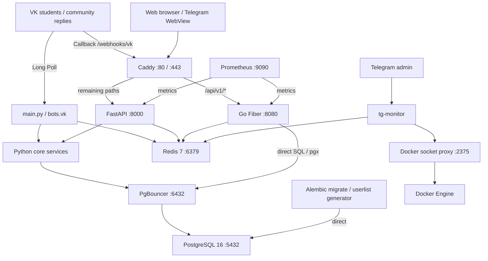

# Независимый аудит Tren_Omni_bot / master

Проверяемый commit: **9898fa4ff9c9640f3c36dc0dbcdf0fb9dca725f5**. Дата: **7 октября 2026**, Europe/Moscow (UTC+3). Аудит выполнен без изменений исходников, конфигурации, миграций и тестов репозитория; без коммитов и PR.

## 1. Executive summary

**Проект не готов к production. Общий риск — высокий, с двумя критическими границами: потеря архивируемых данных и избыточные полномочия Docker Engine.**

Пять главных проблем:

1. **D01:** архивация удаляет историю сообщений; оставшаяся копия лежит в непостоянном контейнере и исчезает при его пересоздании.
2. **D02–D04:** socket proxy допускает опасные изменяющие операции; Go API обходит auth/RBAC, а его SQL не соответствует PostgreSQL enum.
3. **D05–D08:** OTP replay/races, бессрочный fallback-session, неработающая ротация ID и обход актуальных прав в streaming endpoints.
4. **D11–D13:** ACK Callback до durable storage, отсутствие стабильного delivery ID outbox и сообщение UI о доставке по факту queueing.
5. **D16–D21:** штатная конфигурация PgBouncer расходится с режимом Python; backup/restore допускают потерю копии, ложный успех и ошибки загрузки .env; DR-команды не соответствуют сервисам.

Что действительно работает в изолированных проверках: основные Python операции создания, статусов, ответа и истории, обычный RBAC назначенных отделов, CRUD FAQ/БЗ/мероприятий, защита CSRF и большая часть HTML/CSP сценариев. Полный настроенный suite: **573 collected, 568 passed, 3 failed, 2 skipped, 0 xfail**. Дополнительный независимый браузерный сценарий **PASS**: ответ появился в БД и сохранился после reload. Это подтверждает commit/отображение, но не доставку в реальный VK.

Покрытие итогового прогона: **66.96% строк (6797/10151)**, **44.90% ветвей (1179/2626)**, комбинированный показатель pytest-cov **62.4%**. Успех большинства unit tests не проверяет реальный Docker, PostgreSQL migrations, Redis pooling и внешние API.

Отчёт содержит **35 подтверждённых дефектов/несоответствий** с воспроизведением либо полной логической трассировкой. Для результатов по PostgreSQL, Go, Docker и proxy явно указано, где отсутствовал live runtime. «BLOCKED» и «NOT CHECKED» не считаются PASS.

## 2. Паспорт проверки и методика

| Параметр | Факт |
|---|---|
| Репозиторий | https://github.com/KOngfrost/Tren_Omni_bot |
| Целевая ветка | master; origin/master совпадает с указанным SHA |
| Проверенная копия | repository/ внутри рабочей папки аудита |
| Checkout | detached HEAD на точном SHA; локальная master существует. Это фиксация snapshot, не смена целевой ветки |
| git status до аудита | чистое дерево |
| git status / diff после проверок | чистое дерево; git diff --exit-code=0; changed_tracked_files=[] |
| ОС | Windows 11, build 10.0.26300, x64; RuntimeInformation отображает Microsoft Windows 10.0.26300 |
| Python | 3.12.14, встроенный runtime приложения; Python 3.11 и 3.14 не доступны для исполнения |
| Git | 2.55.0.windows.5 |
| Go / Docker / Docker Compose | исполняемые файлы не найдены в PATH; версии не установлены проверкой |
| Ruff / Mypy / Pytest | 0.6.9 / 1.11.2 / 8.2.0 |
| Playwright / Chromium |1.49.1 / 131.0.6778.33 (build 1148), скачаны только в каталог аудита |
| PostgreSQL / Redis | живых изолированных экземпляров нет; не запускались |
| Дата |07.10.2026; начало 13:37 МСК; основные проверки закончены около 14:04 МСК; дальнейшее время — оформление отчёта |

Рабочая папка изначально была пустой, поэтому репозиторий клонирован с полной доступной историей, затем зафиксирован нужный SHA. Никаких рабочих .env, токенов VK/Telegram или production DSN не использовано. В audit-venv установлены опубликованные requirements, дополнительные scanners и браузер. Все временные БД — SQLite с фиктивными данными; отдельный archival probe включал foreign_keys=ON. FakeRedis и HTTP MockTransport проверяют конкретную логику, а не подтверждают работоспособность реальных сервисов.

Перед выполнением прочитаны все 15 обязательных файлов, включая AGENTS.md и весь CHANGELOG.md. Перед операционными probes прочитан код backup/restore/quickstart; hardening/firewall/repair scripts изучены статически, их изменяющие действия не запускались. Backup/restore mock probes использовали неизменённые копии .sh scripts в отдельном каталоге и shell function вместо Docker: **ни один вызов реального Docker, dropdb или psql не происходил**.

pytest runner удаляет внешние DB/VK/Telegram/Redis/Sentry/SMTP параметры из наследуемого окружения, задаёт свои TMP/TEMP, cache/coverage paths и только нужные pytest plugins. Настроенный прогон задаёт POSTGRES_USER=audit_dummy, фиктивный пароль, DB_HOST=127.0.0.1, DB_PORT=1, dummy VK token и ADMIN_VK_IDS=123456789. Фикстуры подменяют БД на memory SQLite; TEST_POSTGRES_URL/TEST_REDIS_URL не заданы. Это дополнительная тестовая конфигурация, не изменение исходников.

Из-за разных Windows identities Git иногда требовал safe.directory; использована только временная опция git -c safe.directory=<эта копия>, без изменения глобального git config. Ограничения sandbox при network/Playwright повторены вне sandbox после разрешения. Все meaningful результаты и точные команды сохранены в logs.

## 3. Фактическая архитектура и инвентаризация

### 3.1. Сервисы, сети, порты и данные

| Service / entrypoint | Сети | Порт | Хранение / зависимости | Фоновые процессы |
|---|---|---|---|---|
| db / postgres:16-alpine |data_net|5432 internal|postgres_data; единственная PostgreSQL БД|PostgreSQL процессы |
| migrate / python -m alembic upgrade head |data_net|нет|прямой db:5432|одноразовое обновление схемы |
| pgbouncer-userlist / generate_pgbouncer_userlist.py |data_net|нет|pg_authid → pgbouncer_config; запуск root|одноразовая генерация SCRAM verifier/config |
| pgbouncer / edoburu v1.23.1-p0 |backend_net,data_net|6432 internal|pgbouncer_config; transaction pool|pool connections |
| bot / python main.py |backend_net|нет входного HTTP|PgBouncer, Redis, VK API|Long Poll или callback idle; daily report, outbox, retention, FSM TTL, heartbeat |
| web-admin / uvicorn web.main:app |frontend_net,backend_net|8000 internal|PgBouncer, Redis; /app/archives и logs без persistent volume|2 workers по умолчанию; outbox, retention, archival, temporary admins, audit flush, Redis Pub/Sub, callback FSM |
| go-api / cmd/server/main.go |frontend_net,backend_net|8080 internal|прямые SQL через pgx; Redis|HTTP handlers/metrics; Python services не вызывает |
| redis / redis:7-alpine |backend_net|6379 internal|redis_data; AOF;256 MB maxmemory/allkeys-lru|cache, sessions, OTP, FSM, distributed locks, maintenance/2FA flags |
| prometheus / v2.53.1 |backend_net|9090 internal|prometheus_data; retention 60 дней|scrape только web-admin и go-api |
| docker-socket-proxy /0.2.0 |socket_net internal|2375 internal|Docker socket с read-only mount; API write permissions включены|HAProxy |
| tg-monitor / run_tg_monitor.py |backend_net,socket_net|нет входного HTTP|Telegram API, Docker proxy, Redis; host bind/var/backups/oss_bot|контейнерные alerts, system/app metrics, daily backup |
| caddy / caddy:2-alpine |frontend_net|80/443 опубликованы на host|Caddyfile; caddy_data/caddy_config|TLS/ACME; HTTP reverse proxy |

12 services, из них 2 одноразовые. На host публикуются только 80/tcp и 443/tcp; 443/udp для заявленного HTTP/3 отсутствует. У Caddy и socket proxy нет healthcheck; у migrate/userlist его отсутствие нормально для jobs. tg-monitor healthcheck проверяет лишь строку /proc/1/cmdline: без настроенного Telegram bot процесс спит и формально остаётся healthy. Compose содержит memory/restart/log limits для постоянных сервисов, но не cap_drop/no-new-privileges/read_only hardening и не pids/CPU limits. Python/Go app images используют непривилегированных пользователей; userlist job использует root. Постоянные volumes для БД/Redis/Prometheus/TLS есть; archive volume отсутствует.

Все компоненты используют одну БД и общий инфраструктурный контур. Это **модульный Python backend с ботами и дополнительным Go HTTP service**, а не независимые бизнес-микросервисы с отдельными storage boundaries. Go дублирует departments/tickets/stats/auth contracts прямым SQL и не вызывает Python TicketService, вопреки стрелке спецификации. API v1 маршруты Python реализованы, но часть затенена Caddy→Go (D30).

В metadata объявлено 17 прикладных таблиц: departments, users, admins, tickets, ticket_messages, web_users, report_runs, knowledge_base, faq_nodes, subscriptions, events, registrations, logs, login_attempts, crud_attempts, vk_outbox, partnership_requests. Дополнительно Alembic хранит version table. SQL таблицы dynamic_settings нет. Общих брокерных очередей нет: исходящая очередь — PostgreSQL vk_outbox; события UI — Redis Pub/Sub; входящие Callback задачи — память процесса.

### 3.2. Внешние зависимости и конфигурационные группы

| Группа | Реальные ключи / особенности |
|---|---|
| БД |POSTGRES_USER/PASSWORD/DB (aliases DB_USER/PASS/NAME); DB_HOST/PORT; DB_USE_PGBOUNCER; DB_POOL_*; DB_STATEMENT_CACHE_SIZE; ALLOW_DB_CREATE |
| VK |VK_BOT_TOKEN; VK_MODE=longpoll/callback; VK_CALLBACK_SECRET; VK_CONFIRMATION_TOKEN; ADMIN_VK_IDS; VK_REPORT_ADMIN_ID; VK_GROUP_URL |
| Веб/сессии |APP_ENV, APP_VERSION, SESSION_SECRET_KEY, SESSION_HTTPS_ONLY, SESSION_SAME_SITE, SESSION_TTL, CORS_ORIGINS, TRUSTED_PROXIES; WEB_WORKERS иFORWARDED_ALLOW_IPS читаются launch command |
| 2FA/bootstrap |TWO_FACTOR_ENABLED/CODE_TTL; WEB_ADMIN_2FA_VK_ID/MAX_ATTEMPTS/RESEND_LIMIT; WEB_ADMIN_USERNAME/PASSWORD; BOOTSTRAP_ALLOWED/FORCE_BOOTSTRAP_OVERRIDE |
| Redis/tasks |REDIS_URL/PASSWORD; CACHE_DEFAULT_TTL; DISTRIBUTED_LOCK_*; BOT_STATE_TTL_SECONDS; WEB_OUTBOX_WORKER; OUTBOX_BATCH_SIZE/INTERVAL/CLAIM_TIMEOUT |
| Telegram |TELEGRAM_BOT_TOKEN, TELEGRAM_ADMIN_ID, TELEGRAM_ALERTS_ENABLED, TELEGRAM_CHECK_INTERVAL_SECONDS, TELEGRAM_WEBAPP_URL; DOCKER_HOST |
| Edge/email/errors |DOMAIN, ACME_EMAIL, APP_TIMEZONE; SMTP_*, REPORT_EMAILS/REPORT_TIME; SENTRY_*, LOG_FORMAT |
| Retention/imports |BACKUP_DIR/ROTATION_DAYS; LOG_IP_RETENTION_DAYS; ARCHIVE_*; AUDIT_LOG_RETENTION_DAYS; OUTBOX_SENT_RETENTION_DAYS; MAX_IMPORT_FILE_SIZE/ROWS; VK_TICKET_RATE_*; CRUD_RATE_* |

VK_MODE, VK_CONFIRMATION_TOKEN, ARCHIVE_* и ряд retention/outbox параметров отсутствуют как готовые строки в .env.example. VK_GROUP_ID из deploy таблицы не используется Settings. Внешний трафик — VK API/Long Poll, Telegram API, SMTP (опционально), Sentry (опционально), ACME; frontend также использует Telegram SDK/Google Fonts. Ни один из этих реальных сервисов в аудите не вызывался с рабочими credentials.

### 3.3. Роли, сценарии и границы

Студент работает через VK: открытое/анонимное обращение, FAQ, БЗ, мероприятия, подписки и партнёрство. Постоянная модель анонимной заявки хранит user_id=NULL и не сохраняет author_vk_id: студент не может получить персональный ответ/историю по этому анонимному обращению. Это полноценная анонимизация идентификаторов в модели, но свободный текст может сам содержать ПДн.

WebRole: SUPERADMIN и DEPARTMENT_ADMIN. UserRole VK: ADMIN и SUPERADMIN. Operator scope назначенных отделов обычно проверяется в Python через БД; общие обращения без отдела доступны всем администраторам, что отличается от ряда формулировок документации. Временные аккаунты имеют expires_at или не связаны с Admin; управление аккаунтами для них ограничено. 2FA имеет глобальный и личный выключатель; временные/QA без VK могут входить без2FA. Telegram-компонент — **бот одного инженера/главного администратора**, не студенческий канал. Он умеет monitoring, restart/logs/backup, maintenance/2FA/kickall и ссылку на WebView; студенческого Telegram ticket workflow и Telegram outbox нет.

Статический граф Python imports имеет4 циклические группы (static-audit.json): telegram bot↔monitor service; vk bot↔handlers; middleware↔templating; auth↔two_factor. Значительная часть imports отложена внутрь функций: импорт приложения в настроенном окружении и tests проходит. Поэтому эти циклы — технический долг, **не подтверждённый стартовый дефект**. Неиспользуемый Go Login остаётся в handlers, но route выключен403; bcrypt login implementation не является активным обходом2FA. В дереве есть admin repair/hardening/diagram scripts, которые не подключены к production entrypoints; это утилиты, а не автоматически «мёртвые компоненты».

## 4. Команды, результаты и ограничения

Точные аргументы основных команд, время wall-clock и exit code лежат в logs/*.json и [COMMANDS.md](COMMANDS.md). Оркестрационные scripts/probes запускались из родительской рабочей папки; report table использует сокращённые пути. Ниже используется PY = audit-venv/Scripts/python.exe, рабочая директорияrepository (дляGo — backend_go). `python -m ruff/mypy/pytest` — тот же CLI выбранной установленной версии, без зависимости от PATH. XML и caches записывались вне repository. Время относится к исполнению команды, не к ожиданию разрешения.

| Проверка / команда | Результат | Время | Доказательство | Ограничение / причина |
|---|---|---:|---|---|
| `PY -m ruff check .` | **FAIL** | 0.760с | [log](logs/ruff.log): I001 core/database.py:149;1 error | Дефект форматирования кода; ничего не исправлено |
| `PY -m ruff format --check .` | **FAIL** | 0.144с | [log](logs/format.log): 3 would reformat;197 formatted | tests/test_new_features.py, test_two_factor_and_bootstrap.py, test_ui_buttons_browser.py |
| `PY -m mypy core web scripts bots` | **PASS** | 53.538с | [log](logs/mypy.log): Success:126 source files | check_untyped_defs=false; многие error codes отключены; PASS имеет ограниченную строгость |
| `PY -m pytest --collect-only -q --no-cov` | **FAIL** | 12.059с | [log](logs/collect.log): 424 tests collected +12 collection errors | Без .env; обязательный config проверяется до fixtures |
| `Та же collect команда + dummy test env` | **PASS** | 8.099с | [log](logs/collect_configured.log): 573 tests collected | SQLite/mocks; реальные Postgres/Redis не подключены |
| `PY -m pytest -q --cov-branch (без .env)` | **FAIL** | 18.072с | [log](logs/pytest.log): 12 collection errors; exit 2 | Дефект test setup, не результат работоспособности функциональных сценариев |
| `PY -m pytest -q --cov-branch + dummy env` | **PARTIAL** | 119.396с | [log](logs/pytest_configured.log): 559 passed/6 failed/6 errors/2 skipped | Первый полный прогон; 10 browser failures/errors связаны с sandbox |
| `PY -m pytest -q --cov-branch --cov-report=xml:coverage-final.xml --junitxml=pytest-final.xml` | **FAIL** | 166.856с | [log](logs/pytestfinal_configured.log): 568 passed / 3 failed / 2 skipped; 0 errors; 573 cases | Итог сChromium;3 дефекта tests; Python 3.12,SQLite |
| `PY -m pytest tests/test_ui_buttons_browser.py tests/test_2fa_ui_and_qa.py -q --no-cov` | **FAIL** | 43.044с | [log](logs/browser_configured.log): 15 passed/1 failed | После установки Chromium; unsafe-eval в test wait_for_function |
| `PY -m pytest audit/browser_independent.py ... --no-cov` | **PASS** | 10.224с | [log](logs/browserindependent_configured.log): 1 passed; reply visible in DB and after reload | Независимый probe вне repo; не подтверждает доставку VK |
| `PY -m alembic heads` | **PASS** | 0.786с | [log](logs/heads.log): i3c4d5e6f7a8 (head) | Без подключения БД; одна head, но есть историческая branch/merge |
| `PY -m alembic history` | **PASS** | 0.621с | [log](logs/history.log): 17 revision files; branchpoint и mergepoint | Upgrade/downgrade на PostgreSQL не проверен |
| `PY -m pip check` | **PASS** | 2.197с | [log](logs/pipcheck.log): No broken requirements found | Resolver consistency, не отсутствие CVE или lock-воспроизводимость |
| `PY -m pip_audit -r requirements.txt -r requirements-dev.txt -f json ...` | **FAIL** | 38.726с | [log](logs/pipaudit.log): 27 advisory entries/5 packages;14 unique | Дефект dependency set; reachability разобрана частично |
| `PY -m bandit -r core web bots -ll -ii -f json ...` | **PARTIAL** | 1.732с | [log](logs/bandit.log): 2 findings; exit 1 | B108 temporary pgpass и B701 icons Environment; см. manual triage |
| `PY -m pip freeze` | **PASS** | 0.833с | [log](logs/freeze.log): Снимок версий всех установленных пакетов | Включает дополнительные audit tools; freeze.log |
| `PY -B audit/probes.py` | PARTIAL |3.89с в одном из повторов|[probes.json](logs/probes.json): OTP/session/archive/privacy/streaming/import/callback proofs|Одноразовая SQLite, FakeRedis, HTTP mock;нет реального Redis/VK |
| `bash -c 'set -e; source .env.example'` |FAIL|0.065с|line 186;exit 127|Совместимость dotenv с Bash |
| CI head regex с реальным именем head |FAIL|0.095с|heads=0; exit 1|[operations-probes.json](logs/operations-probes.json) |
| PowerShell Parser backup.ps1 |FAIL|см.[JSON](logs/powershell-parse.json)|4 syntax errors|Ничего не исполнялось |
| restore.ps1 -BackupFile <synthetic> -Force |FAIL|0.50 с tool wall|$TARGET undefined,line 54|Dummy POSTGRES_*; сбой до Docker/БД |
| backup/restore.sh с подставным Docker |FAIL|см.operations-probes.json|Backup: копия 38→20 bytes после сбоя; restore:SQL ERROR + exit 0|Проверка script control flow; не live DB restore |
| `go vet ./...` |BLOCKED|<0.02с|Go executable not found|Окружение |
| `go test -race -cover ./...` |BLOCKED|<0.02с|Go executable not found|Окружение; Go race/coverage неизвестны |
| `docker compose config` |BLOCKED|<0.02с|Docker executable not found|YAML прочитан статически; Compose CLI не валидирован |
| `docker compose build` (все build services) |BLOCKED|<0.02с|Docker executable not found|Dockerfile/web/monitor/Go не собраны локально |
| `docker compose up -d` / `ps` |BLOCKED|<0.02с|Docker executable not found|Ни один live healthcheck не проверен |
| Чистый deploy, DB upgrade, backup/restore на PostgreSQL |NOT CHECKED|—|Нет Docker/PostgreSQL isolated runtime|Нельзя приравнивать SQLite create_all к миграциям |
| Реальные VK/Telegram/SMTP API |NOT CHECKED|—|Нет токенов и необходимого стенда|Production secrets намеренно не использованы |
| Semgrep / ZAP / gitleaks / govulncheck / container CVE scan |NOT CHECKED|—|Не исполнялись|Конфигурация CI и manual review не равны запуску сканера |
| Python 3.11/3.14 matrix |NOT CHECKED|—|Доступен Python 3.12.14|CI/Docker ориентированы на 3.11; готовность 3.14 не подтверждена |

Первоначально sandbox блокировал сеть clone/pip, каталог cache pip-audit и запуск драйвера Playwright. После разрешения скачивание, scanner и browser выполнены. Эти ошибки окружения не засчитаны как дефекты проекта. Итоговый pytest повторён после изменения браузерного окружения; штатный suite не изменён.

### 4.1. Что говорят тесты и CI на самом деле

В AST найдено 534 определения `test_*`; после параметризации собрано 573 случая. Итоговый прогон: **568 passed, 3 failed, 2 skipped, 0 errors, 0 xfail/0 xpass**. Пропущены `test_postgres_connection` (не задан TEST_POSTGRES_URL) и проверка POSIX-прав backup-файлов (Windows).

В 32 определениях нет оператора `assert`, но многие используют `pytest.raises` или `Mock.assert_called`: это не означает 32 пустых теста. Есть слабые проверки поведения: `test_button_backup_menu` проверяет только ответ после подмены всего backup service; cache TTL test не ждёт истечения TTL; часть SSE tests проверяет форматирование MagicMock, а не авторизацию живого потока. Архивные tests создают Ticket без TicketMessage и поэтому не ловят потерю диалога.

Критичные пробелы: сквозная авторизация через Caddy, PostgreSQL enum и миграции, OTP replay и гонки, два outbox worker при истечении lease, сохранность архивов после recreate, полный охват удаления ПДн, восстановление backup и отзыв долгих потоков. Обычные SQLite fixtures не включают `foreign_keys=ON`, в отличие от независимого archival probe. Даже PostgreSQL fixture создаёт схему через `metadata.drop_all/create_all`, а не Alembic. В CI не задан TEST_REDIS_URL, поэтому фикстуры отключают `settings.REDIS_URL`, хотя Redis service объявлен.

CI строит только Python bot/web images; Dockerfile.monitor и Go Dockerfile не входят в docker-build job. Go vet/race/tests объявлены, но отдельного PostgreSQL integration contract для Go нет. Browser job существует; тестов полного Caddy/PgBouncer/Compose-контура нет. Coverage fail threshold не установлен. Alembic gate проверяет head через ошибочный regex, а upgrade пустой PostgreSQL БД отсутствует.

Mypy PASS относится к 126 файлам, но `check_untyped_defs=False` и многие error codes отключены. Поэтому его результат имеет ограниченную строгость. Python target в CI/Docker — 3.11; ни CI matrix 3.14, ни её локальный прогон не подтверждены.

Pip-audit и gitleaks в YAML блокирующие; Bandit/Semgrep имеют `continue-on-error: true`, ZAP — `fail_action: false`. Наличие job не доказывает обязательность её результата для merge: GitHub branch protection/rulesets не были проверены.

## 5. Реестр дефектов

| ID | Severity | Компонент | Дефект | Доказательство | Влияние | Исправление | Проверка |
|---|---|---|---|---|---|---|---|
| [D01](#d01) | Critical | Архивация / хранилище | Удаление истории и хранение единственной архивной копии в исчезающем контейнере | [core/archival.py:24](https://github.com/KOngfrost/Tren_Omni_bot/blob/9898fa4ff9c9640f3c36dc0dbcdf0fb9dca725f5/core/archival.py#L24); PoC в карточке | Необратимая потеря переписки; после recreate — потеря архивированных обращений и аудита | До исправления отключить удаляющую архивацию | PostgreSQL: архивировать Ticket + сообщения, пересоздать контейнер, восстановить и сравнить все поля |
| [D02](#d02) | Critical | Docker socket proxy | Прокси даёт монитору изменяющий доступ ко всему Docker Engine | [docker-compose.yml:293](https://github.com/KOngfrost/Tren_Omni_bot/blob/9898fa4ff9c9640f3c36dc0dbcdf0fb9dca725f5/docker-compose.yml#L293); PoC в карточке | При компрометации монитора возможны чтение секретов всех контейнеров, выполнение команд и создание контейнера с доступом к файловой системе хоста | Вынести backup/exec из монитора; применить шлюз с allowlist method + path + конкретный container ID и проверкой опасных параметров | В одноразовом Docker: inspect допустимого контейнера разрешён; create с Privileged/Binds, exec чужого контейнера и любые операции над… |
| [D03](#d03) | High | Go API / RBAC | Создание отдела доступно без аутентификации | [backend_go/cmd/server/main.go:79](https://github.com/KOngfrost/Tren_Omni_bot/blob/9898fa4ff9c9640f3c36dc0dbcdf0fb9dca725f5/backend_go/cmd/server/main.go#L79); PoC в карточке | Публичная несанкционированная запись в БД, засорение справочника и обход ролевой модели | Централизовать проверку сессии и RBAC для всех API либо направить эти операции в защищённый Python API; rate limit и audit применить… | Через реальный Caddy: POST с корректным CSRF и без session → 401; оператор → 403; суперadmin → 201 |
| [D04](#d04) | High | Go API / PostgreSQL | Go-запросы используют несуществующие значения enum ticketstatus | [alembic/versions/3e786255e64d_initial_schema.py:27](https://github.com/KOngfrost/Tren_Omni_bot/blob/9898fa4ff9c9640f3c36dc0dbcdf0fb9dca725f5/alembic/versions/3e786255e64d_initial_schema.py#L27); PoC в карточке | Два основных Go API эндпоинта не работают на штатной схеме; публичный Go health при этом сообщает healthy | Согласовать enum-контракт; использовать действительные DB labels и явно преобразовать их в API labels. | Мигрировать пустую PostgreSQL 16, создать NEW и IN_PROGRESS, вызвать оба API, проверить статус, счётчики и значения |
| [D05](#d05) | High | 2FA / OTP | OTP не потребляется атомарно, fallback позволяет повторное использование и сброс попыток | [web/security/otp_store.py:93](https://github.com/KOngfrost/Tren_Omni_bot/blob/9898fa4ff9c9640f3c36dc0dbcdf0fb9dca725f5/web/security/otp_store.py#L93); PoC в карточке | Нарушение одноразовости OTP и обход лимита перебора в отказном режиме; повторная выдача авторизации при гонке | Серверное authoritative OTP state; атомарный consume и счётчик попыток, CAS/Lua; отсутствие ключа означает отказ | 20 одновременных корректных verify: только один ok |
| [D06](#d06) | High | Сессии | Fallback-сессии не имеют серверного срока и отзыва; ротация Redis ID при входе не работает | [web/security/session_store.py:70](https://github.com/KOngfrost/Tren_Omni_bot/blob/9898fa4ff9c9640f3c36dc0dbcdf0fb9dca725f5/web/security/session_store.py#L70); PoC в карточке | Продление жизни похищенной fallback-cookie; logout/kickall не гарантируют её отзыв | Хранить initial_authenticated до вызова app; проверять TTL на сервере; применять session epoch/revocation для всех режимов либо… | После login старый ID недействителен; cookie старше TTL отклонена независимо от Max-Age браузера; logout и kickall отменяют… |
| [D07](#d07) | High | SSE / WebSocket | Потоки обходят актуальную авторизацию и продолжают доверять роли из session | [web/routes/sse.py:363](https://github.com/KOngfrost/Tren_Omni_bot/blob/9898fa4ff9c9640f3c36dc0dbcdf0fb9dca725f5/web/routes/sse.py#L363); PoC в карточке | Удалённая, пониженная или ещё не подтвердившая 2FA сессия может получать сведения о заявках и партнёрстве | Единая авторизация для HTTP/SSE/WS; каноническая роль из БД, проверка истечения и revocation; ограниченный срок потока и повторная… | Открыть потоки, затем revoke/deactivate/demote/expire: поток должен закрыться, новые соединения — 401/1008; pending OTP не даёт данных. |
| [D08](#d08) | High | Уведомления / scope | Оператор без отдела получает превью обращений всех отделов | [web/routes/sse.py:154](https://github.com/KOngfrost/Tren_Omni_bot/blob/9898fa4ff9c9640f3c36dc0dbcdf0fb9dca725f5/web/routes/sse.py#L154); PoC в карточке | Межотдельная утечка текста обращения, темы, номера и отдела даже без доступа к полной карточке | Обрабатывать NULL scope явно и одинаково во всех endpoints; отказ либо фильтр department_id IS NULL. | Оператор без отдела: API counters, SSE и WS не возвращают ни одной профильной заявки другого отдела. |
| [D09](#d09) | High | VK community replies | Префикс номера может записать ответ в заявку другого студента | [core/services/community_reply_service.py:44](https://github.com/KOngfrost/Tren_Omni_bot/blob/9898fa4ff9c9640f3c36dc0dbcdf0fb9dca725f5/core/services/community_reply_service.py#L44); PoC в карточке | Чужой ответ и статус в неверной истории, смешение обращений разных студентов | Убрать глобальный fallback без user_id; проверить получателя и scope до изменения заблокированной строки. | Номер чужого студента и чужая цитата не должны менять его Ticket/Message; проверить обе ветки Callback и Long Poll. |
| [D10](#d10) | High | VK отчёты | Оператор отдела может получить глобальный отчёт с ПДн других отделов | [bots/vk/handlers/reports.py:69](https://github.com/KOngfrost/Tren_Omni_bot/blob/9898fa4ff9c9640f3c36dc0dbcdf0fb9dca725f5/bots/vk/handlers/reports.py#L69); PoC в карточке | ПДн и содержание обращений чужих отделов передаются оператору документом через VK; изоляция UI не защищает этот канал | Передавать канонический scope в отчётный запрос; отдельно проверять право на глобальный отчёт. | Два отдела и два оператора: все три команды отчёта и выгруженный XLSX содержат только допустимые заявки; суперadmin получает полный… |
| [D11](#d11) | High | VK Callback | ACK выдаётся до надёжного сохранения события; replay обрабатывается повторно | [web/routes/vk_callback.py:23](https://github.com/KOngfrost/Tren_Omni_bot/blob/9898fa4ff9c9640f3c36dc0dbcdf0fb9dca725f5/web/routes/vk_callback.py#L23); PoC в карточке | Тихая потеря входящих обращений после ACK, дубли тикетов/сообщений при повторной доставке, гонки FSM при параллельных событиях одного пользователя | Durable inbox с unique(platform, group_id, event_id), commit до ACK, повторяемая обработка и последовательность событий пользователя. | Kill после ACK/до обработки и ошибка DB не теряют событие; 100 одинаковых callback создают одну запись; быстрые шаги FSM сохраняют… |
| [D12](#d12) | High | Transactional outbox | Нет идемпотентности отправки и гарантии восстановления после продолжительного отказа | [core/outbox.py:68](https://github.com/KOngfrost/Tren_Omni_bot/blob/9898fa4ff9c9640f3c36dc0dbcdf0fb9dca725f5/core/outbox.py#L68); PoC в карточке | Дубли ответов, окончательная недоставка после временной аварии, неверная финализация чужого claim | Постоянный VK random_id в outbox; owner token/lease renewal и защищённая финализация; scheduled retries с backoff; наблюдаемая DLQ и… | Mock VK принимает запрос и теряет response: повтор имеет тот же random_id |
| [D13](#d13) | Medium | Ответы / UI | UI сообщает о доставке по факту постановки в очередь; длинный ответ молча обрезается | [core/services/ticket_admin_service.py:50](https://github.com/KOngfrost/Tren_Omni_bot/blob/9898fa4ff9c9640f3c36dc0dbcdf0fb9dca725f5/core/services/ticket_admin_service.py#L50); PoC в карточке | Оператор считает ответ доставленным; студент может не получить ничего или потерять конец существенного ответа | Возвращать delivery_status и outbox ID; UI показывать очередь/ошибку | VK отказ: UI говорит queued, затем sent только после подтверждения |
| [D14](#d14) | High | Удаление ПДн | Процедура удаления оставляет идентифицирующие сведения в партнёрстве, аудитах и архивах | [core/services/privacy_service.py:87](https://github.com/KOngfrost/Tren_Omni_bot/blob/9898fa4ff9c9640f3c36dc0dbcdf0fb9dca725f5/core/services/privacy_service.py#L87); PoC в карточке | Ложное подтверждение удаления, сохранение связи с человеком и ПДн в независимых таблицах/копиях | Определить полный реестр ПДн и retention, удалить/анонимизировать PartnershipRequest, структурированные журналы и архивы; исключить… | Синтетический идентификатор во всех активных таблицах/архивах/логах не находится после erasure, кроме явно документированных… |
| [D15](#d15) | High | Временный доступ | Истёкшая учётка продолжает авторизованные запросы до cleanup, связанная с VK — без cleanup | [web/dependencies.py:94](https://github.com/KOngfrost/Tren_Omni_bot/blob/9898fa4ff9c9640f3c36dc0dbcdf0fb9dca725f5/web/dependencies.py#L94); PoC в карточке | Доступ дольше выданного срока, при linked admin — до ручной деактивации; нарушается граница временного доступа | Проверять is_expired в едином authorize и в обеих OTP ветках; cleanup использовать только для хранения, не как security boundary. | Сессия, выданная до срока, после expiry получает 401; OTP после expiry не выдаёт session; проверить linked и unlinked пользователей. |
| [D16](#d16) | High | PgBouncer / startup | Compose направляет Python в PgBouncer, оставляя прямой режим драйвера | [.env.example:26](https://github.com/KOngfrost/Tren_Omni_bot/blob/9898fa4ff9c9640f3c36dc0dbcdf0fb9dca725f5/.env.example#L26); PoC в карточке | Штатный ручной quickstart способен остановить доступ Python к БД при healthy PostgreSQL/PgBouncer | Явно установить DB_USE_PGBOUNCER=true в app services; проверить SQLAlchemy/asyncpg и pgx prepared statements для зафиксированной… | Чистый Compose из шаблона: Python /health и реальные query проходят; несколько workers и повторная выдача backend connections не… |
| [D17](#d17) | High | Restore | SQL-ошибки восстановления допускают ложный успех после удаления БД | [scripts/restore.sh:54](https://github.com/KOngfrost/Tren_Omni_bot/blob/9898fa4ff9c9640f3c36dc0dbcdf0fb9dca725f5/scripts/restore.sh#L54); PoC в карточке | Пустая или частично восстановленная БД выдаётся за успешное восстановление, исходные данные уже удалены | ON_ERROR_STOP=1 и контролируемая транзакция, где применимо; staging restore с проверкой схемы/данных и переключением только после… | Одноразовая PostgreSQL: намеренно невалидный SQL → ненулевой exit и отсутствие успеха; исходная рабочая копия не уничтожается до… |
| [D18](#d18) | High | Backup | Неудачный повторный backup уничтожает предыдущую копию того же дня | [scripts/backup.sh:42](https://github.com/KOngfrost/Tren_Omni_bot/blob/9898fa4ff9c9640f3c36dc0dbcdf0fb9dca725f5/scripts/backup.sh#L42); PoC в карточке | Потеря последней дневной копии во время аварии | Уникальный timestamp; временный файл с 0600/umask077, проверка дампа и atomic rename после успеха; никогда не обнулять валидную копию… | Существующая валидная копия идентична побайтно после failed повторного dump; все пути копий защищены 0600, каталоги — 0700. |
| [D19](#d19) | High | Bash / .env | Скрипты backup/restore не могут загрузить штатный .env.example | [.env.example:186](https://github.com/KOngfrost/Tren_Omni_bot/blob/9898fa4ff9c9640f3c36dc0dbcdf0fb9dca725f5/.env.example#L186); PoC в карточке | Документированные backup/restore завершаются ещё до работы с БД; автоматический backup может не выполняться | Не исполнять dotenv как shell script: безопасный dotenv parser/явная передача конфигурации | Шаблон после заполнения читается тем же механизмом, что production scripts; значения с пробелами, #, $, кавычками и спецсимволами… |
| [D20](#d20) | Medium | Windows scripts | backup.ps1 синтаксически повреждён; restore.ps1 обращается к переменным до присваивания | [scripts/backup.ps1:26](https://github.com/KOngfrost/Tren_Omni_bot/blob/9898fa4ff9c9640f3c36dc0dbcdf0fb9dca725f5/scripts/backup.ps1#L26); PoC в карточке | Windows backup/restore неработоспособны, независимо от наличия Docker | В отдельной задаче восстановить структуру скриптов и порядок инициализации аргументов; затем проверить без реальных данных. | Parser без ошибок; restore валидирует BackupFile и проходит dry run |
| [D21](#d21) | Medium | Quickstart / DR документация | Команды и переменные развёртывания не соответствуют Compose и Settings | [scripts/quickstart.sh:24](https://github.com/KOngfrost/Tren_Omni_bot/blob/9898fa4ff9c9640f3c36dc0dbcdf0fb9dca725f5/scripts/quickstart.sh#L24); PoC в карточке | Незапуск/отсутствие monitoring, непригодный DR runbook и ложный финальный успех quickstart | Переписать инструкции вокруг действительных Settings и Compose, заполнить полный preflight, проверять health через Caddy/exec;… | Чистая одноразовая Linux VM выполняет инструкции без недокументированных шагов; все сервисы healthy; DR stop/start и bootstrap… |
| [D22](#d22) | High | Зависимости | Штатные зависимости имеют известные advisories; security audit не PASS | [requirements.txt:1](https://github.com/KOngfrost/Tren_Omni_bot/blob/9898fa4ff9c9640f3c36dc0dbcdf0fb9dca725f5/requirements.txt#L1); PoC в карточке | Подтверждён небезопасный набор версий и провал зависимостного security gate; не все advisories означают доказанную удалённую эксплуатацию этого проекта | Обновить согласованный FastAPI/Starlette и прочие уязвимые пакеты; не обновлять Starlette изолированно мимо ограничений FastAPI | pip-audit без неразобранных advisories; form/multipart и SMTP regression tests; Go и container CVE scan выполнить отдельно. |
| [D23](#d23) | Medium | CI / security gates | Alembic gate гарантированно считает 0 heads; SAST/DAST не являются обязательными gates | [.github/workflows/ci.yml:69](https://github.com/KOngfrost/Tren_Omni_bot/blob/9898fa4ff9c9640f3c36dc0dbcdf0fb9dca725f5/.github/workflows/ci.yml#L69); PoC в карточке | Сломанный обязательный migration check и ложная интерпретация зелёного SAST/DAST как отсутствия проблем | Проверять heads через ScriptDirectory, без regex по SHA alphabet; блокирующая согласованная политика SAST/DAST; готовый isolated… | Одна неhex head проходит; две heads блокируют |
| [D24](#d24) | Medium | Тестовый запуск | pytest из чистого окружения падает до применения фикстур | [tests/conftest.py:10](https://github.com/KOngfrost/Tren_Omni_bot/blob/9898fa4ff9c9640f3c36dc0dbcdf0fb9dca725f5/tests/conftest.py#L10); PoC в карточке | Документированная установка и чистый CI тестовый job не воспроизводят заявленный PASS без дополнительных переменных | Отдельный test config устанавливать до application imports; полностью изолировать session factories | Новый checkout + чистый venv + pytest без .env собирает и запускает tests; production env не читается и не используется. |
| [D25](#d25) | Low | Качество checks / тестов | Три штатных теста и два линтера не проходят на неизменённом HEAD | [core/database.py:149](https://github.com/KOngfrost/Tren_Omni_bot/blob/9898fa4ff9c9640f3c36dc0dbcdf0fb9dca725f5/core/database.py#L149); PoC в карточке | Красный CI и недостоверное заявление о 100% PASS | Отдельно согласовать fixture setup с контрактом auth; использовать CSP-совместимые locator assertions | Неизменённый security contract и CSP; все три теста проходят с meaningful assertions, оба Ruff check зелёные. |
| [D26](#d26) | Medium | Модели / миграции | PostgreSQL schema отличается от Base.metadata и тестовой схемы | [core/models.py:35](https://github.com/KOngfrost/Tren_Omni_bot/blob/9898fa4ff9c9640f3c36dc0dbcdf0fb9dca725f5/core/models.py#L35); PoC в карточке | Tests не проверяют production constraints; legacy VIEWER может вызвать LookupError при ORM загрузке | Отдельные согласующие миграции и явное решение для VIEWER; тесты мигрируют пустую БД, затем сравнивают фактическую схему с models. | alembic upgrade head на PostgreSQL16, schema compare без unexplained differences; legacy VIEWER fixture конвертируется согласно… |
| [D27](#d27) | Medium | Rate limiting / отказ | Count-then-write не ограничивает конкурентные запросы; Redis outage снимает лимит VK | [web/security/middleware.py:184](https://github.com/KOngfrost/Tren_Omni_bot/blob/9898fa4ff9c9640f3c36dc0dbcdf0fb9dca725f5/web/security/middleware.py#L184); PoC в карточке | Обход заявленного лимита конкурентной волной; при отказе Redis отсутствует anti-spam и single-leader координация | Атомарный rate-limit reserve (Redis Lua/DB serialization) и ограниченный durable fallback; чёткая fail policy для каждого сервиса,… | 100 одновременных запросов в PostgreSQL/Redis контуре: принятых не больше лимита |
| [D28](#d28) | Medium | Импорт XLSX | Лимит сжатого файла/строк не защищает от расширения ZIP и больших sharedStrings | [core/bulk_import.py:318](https://github.com/KOngfrost/Tren_Omni_bot/blob/9898fa4ff9c9640f3c36dc0dbcdf0fb9dca725f5/core/bulk_import.py#L318); PoC в карточке | Потребление памяти существенно выше лимита; под 640 MiB/256 MiB контейнерами возможен OOM с более крупным файлом или параллельными imports | Проверить ZIP metadata до парсинга: total file_size, compression ratio, размер частей; лимит ячейки и параллельности; изолированный… | Та же маленькая ZIP с чрезмерным expanded size отклоняется до load_workbook; обычные CSV/XLSX imports остаются рабочими. |
| [D29](#d29) | Medium | Аудит действий / logging | При ошибке БД буфер аудита теряет записи; IP не всегда маскируется | [core/audit.py:200](https://github.com/KOngfrost/Tren_Omni_bot/blob/9898fa4ff9c9640f3c36dc0dbcdf0fb9dca725f5/core/audit.py#L200); PoC в карточке | Потеря существенных действий при DB outage/shutdown; неполная доверенность и приватность audit | Durable audit либо requeue с пределом и наблюдаемыми lost-event metrics; drain до пустой очереди при shutdown; единый trusted/masked… | Ошибка insert сохраняет batch для retry; очередь >200 полностью дописывается на shutdown; spoofed XFF от недоверенного клиента не… |
| [D30](#d30) | Medium | Go / Python auth / gateway | Несовместимые session форматы и shadowing Python API дают ложный успех Mini App/logout | [Caddyfile:53](https://github.com/KOngfrost/Tren_Omni_bot/blob/9898fa4ff9c9640f3c36dc0dbcdf0fb9dca725f5/Caddyfile#L53); PoC в карточке | Mini App видит успешный login без авторизации; logout не отзывает Python session; часть документированного Python API за шлюзом недостижима | Единый auth backend/формат и таблица маршрутизации по реально реализованным endpoints; Go не должен иметь фиктивных login/logout… | Через Caddy login → me → protected page → logout →401; Telegram initData login даёт полноценную сессию; API2FA, erasure и department… |
| [D31](#d31) | High | Авторизация / конкурентность | Проверка отдела вынесена за транзакцию изменения заявки | [web/routes/tickets.py:251](https://github.com/KOngfrost/Tren_Omni_bot/blob/9898fa4ff9c9640f3c36dc0dbcdf0fb9dca725f5/web/routes/tickets.py#L251); PoC в карточке | Конкурентный обход разделения отделов, запись ответа или статуса в обращение, к которому доступ уже потерян | Передавать каноническую identity/scope в service и проверять под row lock; изменение scope должно давать403 до записи message/outbox. | Двухтранзакционный PostgreSQL test с barrier между precheck и mutation: после reassignment запрос старого отдела не меняет… |
| [D32](#d32) | Medium | Startup guard | Production принимает очень короткий пароль БД и Callback secret вопреки документации | [core/config.py:434](https://github.com/KOngfrost/Tren_Omni_bot/blob/9898fa4ff9c9640f3c36dc0dbcdf0fb9dca725f5/core/config.py#L434); PoC в карточке | Оператор получает ложную гарантию fail-closed startup и может запустить систему со слабыми конфигурационными секретами | Единая обязательная validation policy на длину/placeholder для нужных секретов; документировать исключения по режиму VK, без… | Production password/Callback secret длиной1 и bootstrap password10–11 отклонены; достаточные ephemeral значения проходят |
| [D33](#d33) | Medium | Документация / готовность | Бенчмарки, capacity, RPO и обязательные security заявления не подтверждаются текущим кодом | [docs/PERFORMANCE_AND_BENCHMARKS.md:23](https://github.com/KOngfrost/Tren_Omni_bot/blob/9898fa4ff9c9640f3c36dc0dbcdf0fb9dca725f5/docs/PERFORMANCE_AND_BENCHMARKS.md#L23); PoC в карточке | Решения о capacity/надёжности/production принимаются по непроверяемым цифрам и несуществующим функциям | Убрать неподтверждённые guarantees, опубликовать raw benchmark с SHA и актуальными маршрутами; реализовать capacity/WAL или честно… | Benchmark проверяет persisted operation и реальные status codes, RPO испытан при уничтожении одноразового хоста; capacity test с… |
| [D34](#d34) | Medium | Нумерация / архивация | Персональный номер заявки переиспользуется после удаления старой заявки | [core/repositories/ticket_repo.py:63](https://github.com/KOngfrost/Tren_Omni_bot/blob/9898fa4ff9c9640f3c36dc0dbcdf0fb9dca725f5/core/repositories/ticket_repo.py#L63); PoC в карточке | Ответ студента направляется в другое его обращение; переписка и уведомления смешиваются даже без злонамеренного пользователя | Постоянный user-scoped sequence/номер с уникальным constraint, без перерасчёта по оставшимся строкам; tombstone для архивных номеров. | Номер активной заявки одинаков до/после архивации/erasure; старый номер не указывает на новую заявку; конкурирующее создание не даёт… |
| [D35](#d35) | Medium | Monitoring / readiness | Здоровье процессов не подтверждает зависимости; часть Prometheus alerts не имеет источника метрик | [backend_go/internal/handlers/handlers.go:206](https://github.com/KOngfrost/Tren_Omni_bot/blob/9898fa4ff9c9640f3c36dc0dbcdf0fb9dca725f5/backend_go/internal/handlers/handlers.go#L206); PoC в карточке | Зелёный Compose health может скрыть неработающий монитор и зависимость; business alerts по heartbeat/outbox/Redis не сработают без time series | Разделить liveness/readiness и optional disabled status; реализовать gauges/exporters, absent alerts и доставку alerts; проверять… | В isolated stack отключить DB/Redis/Telegram config и заполнить outbox: ожидаемые readiness/alerts меняются; проверить end-to-end… |

Каждая карточка ниже содержит путь/строки, сценарий, ожидание/факт, влияние, минимальное исправление и проверку. **Dynamic** означает исполнение на изолированных данных; **logical trace** — доказанное поведение по маршрутам/ветвям, без заявления об исполнении production stack.

### D01 — Critical: Удаление истории и хранение единственной архивной копии в исчезающем контейнере

**Файлы и строки:** [core/archival.py:24–87](https://github.com/KOngfrost/Tren_Omni_bot/blob/9898fa4ff9c9640f3c36dc0dbcdf0fb9dca725f5/core/archival.py#L24-L87), [core/models.py:147–171](https://github.com/KOngfrost/Tren_Omni_bot/blob/9898fa4ff9c9640f3c36dc0dbcdf0fb9dca725f5/core/models.py#L147-L171), [web/main.py:69–74](https://github.com/KOngfrost/Tren_Omni_bot/blob/9898fa4ff9c9640f3c36dc0dbcdf0fb9dca725f5/web/main.py#L69-L74), [docker-compose.yml:187–225](https://github.com/KOngfrost/Tren_Omni_bot/blob/9898fa4ff9c9640f3c36dc0dbcdf0fb9dca725f5/docker-compose.yml#L187-L225).

**Доказательство:** Динамически подтверждено: probes.json → archive_history; отсутствие тома подтверждено Compose

**Подтверждённый сценарий:** Создать выполненную заявку старше 90 дней с несколькими TicketMessage, выполнить archive_and_delete_tickets, затем пересоздать web-admin при обновлении образа. Независимая проверка включала PRAGMA foreign_keys=ON; реальные данные не использовались.

**Ожидаемое поведение:** Полный диалог и метаданные должны оставаться в проверенном постоянном архиве и восстанавливаться после обновления.

**Фактическое поведение:** Архив содержит только поля Ticket, без TicketMessage и auto_closed. CASCADE удаляет сообщения: проверка дала remaining_messages=0 и archive_has_dialogue=false. archives/ по умолчанию находится в /app контейнера, а web-admin не имеет тома для него. Пересоздание контейнера уничтожит оставшуюся копию заявок и логов. Удаление по id также не перепроверяет актуальный статус после чтения; параллельное переоткрытие может быть удалено.

Дополнительно `core/rate_limit_cleanup.py:65–77` удаляет Log старше тех же 90 дней напрямую, без архива. Наличие второго job означает, что сохранение всех старых audit logs архиватором также не гарантируется.

**Влияние:** Необратимая потеря переписки; после recreate — потеря архивированных обращений и аудита. Это штатный путь фонового задания, а не только аварийный сценарий.

**Минимальная рекомендация:** До исправления отключить удаляющую архивацию. Хранить полный снимок в постоянном томе/объектном хранилище; проверять запись, целостность и восстановление до удаления; координировать удаление с изменением заявки.

**Проверка исправления:** PostgreSQL: архивировать Ticket + сообщения, пересоздать контейнер, восстановить и сравнить все поля. В двух транзакциях переоткрыть заявку во время архивации: она должна сохраниться.

### D02 — Critical: Прокси даёт монитору изменяющий доступ ко всему Docker Engine

**Файлы и строки:** [docker-compose.yml:293–340](https://github.com/KOngfrost/Tren_Omni_bot/blob/9898fa4ff9c9640f3c36dc0dbcdf0fb9dca725f5/docker-compose.yml#L293-L340), [SECURITY.md:17–25](https://github.com/KOngfrost/Tren_Omni_bot/blob/9898fa4ff9c9640f3c36dc0dbcdf0fb9dca725f5/SECURITY.md#L17-L25).

**Доказательство:** Подтверждено настройками и ACL точной версии; Docker runtime BLOCKED. Внешний источник: https://raw.githubusercontent.com/Tecnativa/docker-socket-proxy/v0.2.0/haproxy.cfg

**Подтверждённый сценарий:** Процесс с доступом к socket_net, включая скомпрометированный tg-monitor, обращается к docker-socket-proxy:2375. Не требуется доступ с публичного Интернета.

**Ожидаемое поведение:** Разрешены только конкретные операции над контейнерами проекта, без создания привилегированных контейнеров, host bind mounts и произвольного exec.

**Фактическое поведение:** CONTAINERS=1, EXEC=1 и POST=1 включены. В официальном haproxy.cfg v0.2.0 проверка POST пропускает изменяющие методы, а правило /containers разрешает всю секцию, включая /containers/create. Политика не проверяет тело запроса, bind mounts или идентичность проекта. DELETE=0 не участвует в ACL этого тега. Монтирование docker.sock:ro не запрещает изменяющие команды API.

**Влияние:** При компрометации монитора возможны чтение секретов всех контейнеров, выполнение команд и создание контейнера с доступом к файловой системе хоста. Это переход от одного непривилегированного приложения к компрометации хоста.

**Минимальная рекомендация:** Вынести backup/exec из монитора; применить шлюз с allowlist method + path + конкретный container ID и проверкой опасных параметров. Разделить мониторинг и привилегированный maintenance agent.

**Проверка исправления:** В одноразовом Docker: inspect допустимого контейнера разрешён; create с Privileged/Binds, exec чужого контейнера и любые операции над чужим проектом получают 403. Эксплуатация на этом компьютере не выполнялась.

### D03 — High: Создание отдела доступно без аутентификации

**Файлы и строки:** [backend_go/cmd/server/main.go:79–100](https://github.com/KOngfrost/Tren_Omni_bot/blob/9898fa4ff9c9640f3c36dc0dbcdf0fb9dca725f5/backend_go/cmd/server/main.go#L79-L100), [backend_go/internal/handlers/handlers.go:90–149](https://github.com/KOngfrost/Tren_Omni_bot/blob/9898fa4ff9c9640f3c36dc0dbcdf0fb9dca725f5/backend_go/internal/handlers/handlers.go#L90-L149), [backend_go/internal/handlers/handlers.go:284–313](https://github.com/KOngfrost/Tren_Omni_bot/blob/9898fa4ff9c9640f3c36dc0dbcdf0fb9dca725f5/backend_go/internal/handlers/handlers.go#L284-L313), [Caddyfile:53–66](https://github.com/KOngfrost/Tren_Omni_bot/blob/9898fa4ff9c9640f3c36dc0dbcdf0fb9dca725f5/Caddyfile#L53-L66).

**Доказательство:** Полная логическая трассировка маршрута, middleware и SQL; Go/Docker runtime не проверен

**Подтверждённый сценарий:** Анонимный клиент выполняет GET /api/v1/health, получает csrf_token cookie и передаёт её вместе с X-CSRF-Token в POST /api/v1/departments/.

**Ожидаемое поведение:** Создание отдела разрешено только актуальному SUPERADMIN; анонимному пользователю — 401, оператору отдела — 403.

**Фактическое поведение:** Группа Go содержит CSRFProtect, но не auth middleware. CSRF cookie не подтверждает личность; CreateDepartment сразу выполняет INSERT. GetDepartments также не фильтрует область доступа. Caddy направляет эти URL именно в Go, обходя require_superadmin из Python.

**Влияние:** Публичная несанкционированная запись в БД, засорение справочника и обход ролевой модели. Чтение списка отделов также публично. GetTickets сейчас дополнительно сломан D04: успешную утечку полного списка тикетов через этот маршрут не заявляю.

**Минимальная рекомендация:** Централизовать проверку сессии и RBAC для всех API либо направить эти операции в защищённый Python API; rate limit и audit применить после проверки пользователя.

**Проверка исправления:** Через реальный Caddy: POST с корректным CSRF и без session → 401; оператор → 403; суперadmin → 201. Повторить для чтения отделов и тикетов.

### D04 — High: Go-запросы используют несуществующие значения enum ticketstatus

**Файлы и строки:** [alembic/versions/3e786255e64d_initial_schema.py:27–38](https://github.com/KOngfrost/Tren_Omni_bot/blob/9898fa4ff9c9640f3c36dc0dbcdf0fb9dca725f5/alembic/versions/3e786255e64d_initial_schema.py#L27-L38), [core/models.py:47–54](https://github.com/KOngfrost/Tren_Omni_bot/blob/9898fa4ff9c9640f3c36dc0dbcdf0fb9dca725f5/core/models.py#L47-L54), [backend_go/internal/handlers/handlers.go:226](https://github.com/KOngfrost/Tren_Omni_bot/blob/9898fa4ff9c9640f3c36dc0dbcdf0fb9dca725f5/backend_go/internal/handlers/handlers.go#L226), [backend_go/internal/handlers/handlers.go:328](https://github.com/KOngfrost/Tren_Omni_bot/blob/9898fa4ff9c9640f3c36dc0dbcdf0fb9dca725f5/backend_go/internal/handlers/handlers.go#L328).

**Доказательство:** Логическая трассировка миграции и SQL; правило case-sensitive enum подтверждено PostgreSQL docs. Live SQL BLOCKED

**Подтверждённый сценарий:** На БД, созданной штатными миграциями, вызвать GET /api/v1/stats и GET /api/v1/tickets/.

**Ожидаемое поведение:** Статистика и список заявок возвращают 200, используя NEW/IN_PROGRESS и согласованные значения статуса.

**Фактическое поведение:** PostgreSQL ENUM содержит NEW, IN_PROGRESS и другие имена в верхнем регистре. Go сравнивает его с 'new', 'in_progress' и использует COALESCE(t.status, 'new'). PostgreSQL приводит эти литералы к enum; таких меток нет, поэтому запрос некорректен и handler возвращает 500. Это не просто неверный нулевой счётчик.

**Влияние:** Два основных Go API эндпоинта не работают на штатной схеме; публичный Go health при этом сообщает healthy.

**Минимальная рекомендация:** Согласовать enum-контракт; использовать действительные DB labels и явно преобразовать их в API labels.

**Проверка исправления:** Мигрировать пустую PostgreSQL 16, создать NEW и IN_PROGRESS, вызвать оба API, проверить статус, счётчики и значения. Проверять на PostgreSQL, не SQLite.

### D05 — High: OTP не потребляется атомарно, fallback позволяет повторное использование и сброс попыток

**Файлы и строки:** [web/security/otp_store.py:93–148](https://github.com/KOngfrost/Tren_Omni_bot/blob/9898fa4ff9c9640f3c36dc0dbcdf0fb9dca725f5/web/security/otp_store.py#L93-L148), [web/security/otp_store.py:226–254](https://github.com/KOngfrost/Tren_Omni_bot/blob/9898fa4ff9c9640f3c36dc0dbcdf0fb9dca725f5/web/security/otp_store.py#L226-L254).

**Доказательство:** Динамически: otp_cookie_replay, otp_redis_race_and_deleted_key; FakeRedis моделирует хранилище и барьер конкурентного GET, не реальный Redis

**Подтверждённый сценарий:** Без Redis сохранить cookie до ввода OTP; после успешного ввода вернуть прежнюю cookie. При работающем хранилище отправить два запроса проверки одновременно, пока оба прочитали один state.

**Ожидаемое поведение:** OTP принимается ровно один раз; попытки увеличиваются атомарно; удалённая попытка не восстанавливается из старой клиентской сессии.

**Фактическое поведение:** Два конкурентных verify вернули ok/ok. В cookie fallback повторная проверка старого snapshot вернула ok; семь ошибочных запросов с одним snapshot каждый показали remaining=4. _persist всегда кладёт full state в session; _load при отсутствующем Redis key возвращается к state из session, а GET/verify/DELETE не атомарны. В здоровом Redis браузер обычно хранит ID сессии: последовательный replay cookie не равен произвольному восстановлению server-side state; подтверждённая безлимитная ветка относится к cookie fallback, а гонка — к параллельным запросам.

Дополнительная граница хранения: `web/routes/auth.py:227–241` сохраняет открытый OTP в `VkOutbox.text` для доставки. Хеширование state в Redis не означает, что код нигде не хранится открыто; sent outbox удаляется по отдельному retention. Сам по себе этот факт не объявляется дополнительным remote exploit.

**Влияние:** Нарушение одноразовости OTP и обход лимита перебора в отказном режиме; повторная выдача авторизации при гонке.

**Минимальная рекомендация:** Серверное authoritative OTP state; атомарный consume и счётчик попыток, CAS/Lua; отсутствие ключа означает отказ. Не хранить восстанавливаемый state попытки в клиентской cookie.

**Проверка исправления:** 20 одновременных корректных verify: только один ok. Повтор старой cookie, удалённого token и старого OTP после resend: отказ. Ошибочные запросы в параллели исчерпывают единый лимит.

### D06 — High: Fallback-сессии не имеют серверного срока и отзыва; ротация Redis ID при входе не работает

**Файлы и строки:** [web/security/session_store.py:70–99](https://github.com/KOngfrost/Tren_Omni_bot/blob/9898fa4ff9c9640f3c36dc0dbcdf0fb9dca725f5/web/security/session_store.py#L70-L99), [web/security/session_store.py:150–199](https://github.com/KOngfrost/Tren_Omni_bot/blob/9898fa4ff9c9640f3c36dc0dbcdf0fb9dca725f5/web/security/session_store.py#L150-L199), [web/routes/auth.py:572–587](https://github.com/KOngfrost/Tren_Omni_bot/blob/9898fa4ff9c9640f3c36dc0dbcdf0fb9dca725f5/web/routes/auth.py#L572-L587).

**Доказательство:** Динамически: expired_fallback_session и session_fixation; криптографическая подпись/шифрование сами по себе работают

**Подтверждённый сценарий:** Проверить fallback token возрастом сутки при max_age=60. Сохранить cookie до logout и предъявить её повторно. Для Redis выполнить вход в существующей анонимной сессии.

**Ожидаемое поведение:** Сервер отказывает просроченной и отозванной cookie, после входа выдаёт новый ID и удаляет старый.

**Фактическое поведение:** Fernet.decrypt вызван без ttl, Signer также не проверяет возраст. Проверка приняла token возрастом 86400 сек при max_age=60. Удаление cookie в браузере не отзывает её сохранённую копию. data и current_session — один изменяемый dict; was_authenticated вычисляется после добавления user и уже True, поэтому ID не меняется: probe session_id_rotated=false, old_redis_session_still_present=true.

**Влияние:** Продление жизни похищенной fallback-cookie; logout/kickall не гарантируют её отзыв. При известном/навязанном pre-login ID сохраняется session fixation. Наличие ID у атакующего является дополнительным условием, самостоятельный способ похищения cookie здесь не заявляется.

**Минимальная рекомендация:** Хранить initial_authenticated до вызова app; проверять TTL на сервере; применять session epoch/revocation для всех режимов либо production fail-closed без cookie fallback.

**Проверка исправления:** После login старый ID недействителен; cookie старше TTL отклонена независимо от Max-Age браузера; logout и kickall отменяют сохранённую cookie в Redis и fallback.

### D07 — High: Потоки обходят актуальную авторизацию и продолжают доверять роли из session

**Файлы и строки:** [web/routes/sse.py:363–384](https://github.com/KOngfrost/Tren_Omni_bot/blob/9898fa4ff9c9640f3c36dc0dbcdf0fb9dca725f5/web/routes/sse.py#L363-L384), [web/routes/sse.py:396–449](https://github.com/KOngfrost/Tren_Omni_bot/blob/9898fa4ff9c9640f3c36dc0dbcdf0fb9dca725f5/web/routes/sse.py#L396-L449), [web/dependencies.py:264–281](https://github.com/KOngfrost/Tren_Omni_bot/blob/9898fa4ff9c9640f3c36dc0dbcdf0fb9dca725f5/web/dependencies.py#L264-L281).

**Доказательство:** Динамический probe sse_removed_superadmin_leak плюс трассировка handlers; длительный production-поток не запускался

**Подтверждённый сценарий:** После открытия потока удалить/деактивировать суперadmin, понизить роль или завершить срок; оставить соединение либо повторить запрос со старой cookie.

**Ожидаемое поведение:** Проверка канонического пользователя перед открытием и периодический отзыв доступа в долгом потоке.

**Фактическое поведение:** sse_stream/websocket_stream проверяют только наличие user. require_auth не вызывается. get_admin_scope для роли SUPERADMIN сразу возвращает полный scope. Probe с несуществующим web_user_id=999999 и SUPERADMIN получил items. Стрим также не применяет блокировку pending_2fa из require_auth.

**Влияние:** Удалённая, пониженная или ещё не подтвердившая 2FA сессия может получать сведения о заявках и партнёрстве. Cookie fallback D06 усиливает длительность доступа.

**Минимальная рекомендация:** Единая авторизация для HTTP/SSE/WS; каноническая роль из БД, проверка истечения и revocation; ограниченный срок потока и повторная проверка.

**Проверка исправления:** Открыть потоки, затем revoke/deactivate/demote/expire: поток должен закрыться, новые соединения — 401/1008; pending OTP не даёт данных.

### D08 — High: Оператор без отдела получает превью обращений всех отделов

**Файлы и строки:** [web/routes/sse.py:154–193](https://github.com/KOngfrost/Tren_Omni_bot/blob/9898fa4ff9c9640f3c36dc0dbcdf0fb9dca725f5/web/routes/sse.py#L154-L193), [web/routes/api.py:370–419](https://github.com/KOngfrost/Tren_Omni_bot/blob/9898fa4ff9c9640f3c36dc0dbcdf0fb9dca725f5/web/routes/api.py#L370-L419).

**Доказательство:** Динамически: sse_no_department_leak; аналогичный код HTTP counters подтверждён чтением

**Подтверждённый сценарий:** Действующий DEPARTMENT_ADMIN имеет department_id=NULL; существуют NEW заявки профильного отдела.

**Ожидаемое поведение:** Такому оператору доступны только явно разрешённые общие обращения либо доступ запрещён.

**Фактическое поведение:** Условие not is_super and dept_id ложно при NULL; ограничение department_id не добавляется в base_scope. Обе реализации выбирают NEW заявки всех отделов. Probe показал private_preview_visible=true для чужого профильного обращения.

**Влияние:** Межотдельная утечка текста обращения, темы, номера и отдела даже без доступа к полной карточке.

**Минимальная рекомендация:** Обрабатывать NULL scope явно и одинаково во всех endpoints; отказ либо фильтр department_id IS NULL.

**Проверка исправления:** Оператор без отдела: API counters, SSE и WS не возвращают ни одной профильной заявки другого отдела.

### D09 — High: Префикс номера может записать ответ в заявку другого студента

**Файлы и строки:** [core/services/community_reply_service.py:44–67](https://github.com/KOngfrost/Tren_Omni_bot/blob/9898fa4ff9c9640f3c36dc0dbcdf0fb9dca725f5/core/services/community_reply_service.py#L44-L67), [core/services/community_reply_service.py:297–351](https://github.com/KOngfrost/Tren_Omni_bot/blob/9898fa4ff9c9640f3c36dc0dbcdf0fb9dca725f5/core/services/community_reply_service.py#L297-L351).

**Доказательство:** Динамически: community_cross_user_prefix

**Подтверждённый сценарий:** Ответ отправлен студенту A, но начинается с глобального номера заявки B, не принадлежащей A и не соответствующей его локальному номеру.

**Ожидаемое поведение:** Заявка ищется только среди обращений реального получателя; ошибочный номер не меняет чужое обращение.

**Фактическое поведение:** Последний fallback _find_ticket_by_id_or_local_num ищет Ticket.id==num без user_id. Probe для A(user_id=1), текста #999 выбрал заявку B(user_id=2). handle затем добавляет ADMIN message и меняет status/response_text. Привязка пользователя отсутствует именно в завершающей ветке.

**Влияние:** Чужой ответ и статус в неверной истории, смешение обращений разных студентов. Отдельно положительный admin_author_id не подтверждает права по отделу; это дополнительная граница для уточнения политики community operators.

**Минимальная рекомендация:** Убрать глобальный fallback без user_id; проверить получателя и scope до изменения заблокированной строки.

**Проверка исправления:** Номер чужого студента и чужая цитата не должны менять его Ticket/Message; проверить обе ветки Callback и Long Poll.

### D10 — High: Оператор отдела может получить глобальный отчёт с ПДн других отделов

**Файлы и строки:** [bots/vk/handlers/reports.py:69–102](https://github.com/KOngfrost/Tren_Omni_bot/blob/9898fa4ff9c9640f3c36dc0dbcdf0fb9dca725f5/bots/vk/handlers/reports.py#L69-L102), [core/bot_core.py:88–115](https://github.com/KOngfrost/Tren_Omni_bot/blob/9898fa4ff9c9640f3c36dc0dbcdf0fb9dca725f5/core/bot_core.py#L88-L115), [core/reports/period.py:35–82](https://github.com/KOngfrost/Tren_Omni_bot/blob/9898fa4ff9c9640f3c36dc0dbcdf0fb9dca725f5/core/reports/period.py#L35-L82).

**Доказательство:** Динамический unscoped report query + логическая трассировка bot handler; реальный документ в VK не отправлялся

**Подтверждённый сценарий:** Назначенный Admin обычного отдела вызывает отчёт за сегодня/дату/период.

**Ожидаемое поведение:** Отчёт ограничен его отделом; глобальный отчёт доступен SUPERADMIN.

**Фактическое поведение:** Handler проверяет только BotCore.is_admin, одинаково True для ADMIN и SUPERADMIN. _fetch_report_data ограничивает только период, выбирая Department, User.full_name/dormitory, description и response_text по всем отделам. Передать department scope функции невозможно. Probe global report содержит Audit B.

**Влияние:** ПДн и содержание обращений чужих отделов передаются оператору документом через VK; изоляция UI не защищает этот канал.

**Минимальная рекомендация:** Передавать канонический scope в отчётный запрос; отдельно проверять право на глобальный отчёт.

**Проверка исправления:** Два отдела и два оператора: все три команды отчёта и выгруженный XLSX содержат только допустимые заявки; суперadmin получает полный отчёт.

### D11 — High: ACK выдаётся до надёжного сохранения события; replay обрабатывается повторно

**Файлы и строки:** [web/routes/vk_callback.py:23–58](https://github.com/KOngfrost/Tren_Omni_bot/blob/9898fa4ff9c9640f3c36dc0dbcdf0fb9dca725f5/web/routes/vk_callback.py#L23-L58), [web/routes/vk_callback.py:97–118](https://github.com/KOngfrost/Tren_Omni_bot/blob/9898fa4ff9c9640f3c36dc0dbcdf0fb9dca725f5/web/routes/vk_callback.py#L97-L118), [web/main.py:121–139](https://github.com/KOngfrost/Tren_Omni_bot/blob/9898fa4ff9c9640f3c36dc0dbcdf0fb9dca725f5/web/main.py#L121-L139).

**Доказательство:** Динамически: callback_ack_and_replay; настоящий VK не использовался

**Подтверждённый сценарий:** VK присылает event_id, webhook возвращает ok; затем процесс падает или обработка БД завершается ошибкой. Повторить тот же event_id.

**Ожидаемое поведение:** До ACK событие должно попасть в durable inbox; одинаковый event_id применяется один раз, ошибка допускает повтор обработки.

**Фактическое поведение:** Событие передаётся в asyncio.create_task, сохраняется только ссылка в памяти и сразу возвращается 200 ok. Исключение только журналируется. Дедупликации event_id нет; lifespan не дожидается _callback_tasks. Probe: два ok до начала обработки, два вызова одного event_id, оба с исключением.

**Влияние:** Тихая потеря входящих обращений после ACK, дубли тикетов/сообщений при повторной доставке, гонки FSM при параллельных событиях одного пользователя.

**Минимальная рекомендация:** Durable inbox с unique(platform, group_id, event_id), commit до ACK, повторяемая обработка и последовательность событий пользователя.

**Проверка исправления:** Kill после ACK/до обработки и ошибка DB не теряют событие; 100 одинаковых callback создают одну запись; быстрые шаги FSM сохраняют порядок.

### D12 — High: Нет идемпотентности отправки и гарантии восстановления после продолжительного отказа

**Файлы и строки:** [core/outbox.py:68–149](https://github.com/KOngfrost/Tren_Omni_bot/blob/9898fa4ff9c9640f3c36dc0dbcdf0fb9dca725f5/core/outbox.py#L68-L149), [core/vk_client.py:24](https://github.com/KOngfrost/Tren_Omni_bot/blob/9898fa4ff9c9640f3c36dc0dbcdf0fb9dca725f5/core/vk_client.py#L24), [core/vk_client.py:70–88](https://github.com/KOngfrost/Tren_Omni_bot/blob/9898fa4ff9c9640f3c36dc0dbcdf0fb9dca725f5/core/vk_client.py#L70-L88), [core/task_dispatcher.py:90–113](https://github.com/KOngfrost/Tren_Omni_bot/blob/9898fa4ff9c9640f3c36dc0dbcdf0fb9dca725f5/core/task_dispatcher.py#L90-L113).

**Доказательство:** random_id воспроизведён; fixed retries/claim races подтверждены трассировкой. PostgreSQL многопроцессная проверка BLOCKED

**Подтверждённый сценарий:** VK принял сообщение, но HTTP response потерян или процесс упал до отметки sent; повторная доставка. Отдельно VK недоступен дольше пяти циклов. При долгой партии первый worker ещё отправляет, а claim уже старше 300 секунд.

**Ожидаемое поведение:** Повтор одной outbox записи имеет постоянный delivery ID; временный outage не делает сообщение навсегда недоставляемым; claim принадлежит конкретному живому worker.

**Фактическое поведение:** random_id создаётся заново на каждый вызов messages.send: probe same_message_same_random_id=false. После 5 попыток status=failed, worker выбирает только pending; публичного requeue workflow не найдено. Между retries нет per-message backoff/next_retry. 50 последовательных HTTP timeout по 10 сек могут превысить claim TTL 300 сек. Статус sending проверяется при завершении без owner token, и другой worker может переclaim живую партию; fire_outbox_delivery обходит общий Redis guard.

**Влияние:** Дубли ответов, окончательная недоставка после временной аварии, неверная финализация чужого claim. Обещание «ни одно сообщение не потеряется» не обеспечено.

**Минимальная рекомендация:** Постоянный VK random_id в outbox; owner token/lease renewal и защищённая финализация; scheduled retries с backoff; наблюдаемая DLQ и безопасный requeue.

**Проверка исправления:** Mock VK принимает запрос и теряет response: повтор имеет тот же random_id. После outage >5 попыток восстановление доставляет запись. Два PostgreSQL worker с задержкой >TTL не отправляют и не завершают чужой claim.

### D13 — Medium: UI сообщает о доставке по факту постановки в очередь; длинный ответ молча обрезается

**Файлы и строки:** [core/services/ticket_admin_service.py:50–66](https://github.com/KOngfrost/Tren_Omni_bot/blob/9898fa4ff9c9640f3c36dc0dbcdf0fb9dca725f5/core/services/ticket_admin_service.py#L50-L66), [web/routes/tickets.py:379–415](https://github.com/KOngfrost/Tren_Omni_bot/blob/9898fa4ff9c9640f3c36dc0dbcdf0fb9dca725f5/web/routes/tickets.py#L379-L415), [web/templates/tickets.html:405](https://github.com/KOngfrost/Tren_Omni_bot/blob/9898fa4ff9c9640f3c36dc0dbcdf0fb9dca725f5/web/templates/tickets.html#L405), [core/vk_client.py:78](https://github.com/KOngfrost/Tren_Omni_bot/blob/9898fa4ff9c9640f3c36dc0dbcdf0fb9dca725f5/core/vk_client.py#L78).

**Доказательство:** Динамически: reply_delivery_flag, outbox_random_id_and_truncation; независимый browser persistence PASS

**Подтверждённый сценарий:** Ответить на открытый тикет при неработающем VK. Отправить ответ длиннее 4000 символов.

**Ожидаемое поведение:** UI различает saved/queued/sent/failed; пользователь получает полный разрешённый текст либо явную ошибку длины.

**Фактическое поведение:** Возвращаемый bool scheduled назван vk_sent. Probe: flag=true, outbox=pending, network_calls=0. UI выводит «Ответ отправлен студенту в VK». Роут не ограничивает длину ответа, а VK client посылает text[:4000]; probe 5000 символов превратился в 4000. В БД и UI остаётся полный текст.

**Влияние:** Оператор считает ответ доставленным; студент может не получить ничего или потерять конец существенного ответа. Проблема не означает отсутствия commit: сохранение отдельно подтверждено браузером.

**Минимальная рекомендация:** Возвращать delivery_status и outbox ID; UI показывать очередь/ошибку. Валидировать длину с учётом префикса либо разбивать сообщение на идемпотентные части.

**Проверка исправления:** VK отказ: UI говорит queued, затем sent только после подтверждения. Ответ > лимита либо отклоняется до commit, либо все части доходят полностью.

### D14 — High: Процедура удаления оставляет идентифицирующие сведения в партнёрстве, аудитах и архивах

**Файлы и строки:** [core/services/privacy_service.py:87–140](https://github.com/KOngfrost/Tren_Omni_bot/blob/9898fa4ff9c9640f3c36dc0dbcdf0fb9dca725f5/core/services/privacy_service.py#L87-L140), [core/models.py:457–480](https://github.com/KOngfrost/Tren_Omni_bot/blob/9898fa4ff9c9640f3c36dc0dbcdf0fb9dca725f5/core/models.py#L457-L480), [web/routes/api_v1.py:632–653](https://github.com/KOngfrost/Tren_Omni_bot/blob/9898fa4ff9c9640f3c36dc0dbcdf0fb9dca725f5/web/routes/api_v1.py#L632-L653), [core/archival.py:59–80](https://github.com/KOngfrost/Tren_Omni_bot/blob/9898fa4ff9c9640f3c36dc0dbcdf0fb9dca725f5/core/archival.py#L59-L80).

**Доказательство:** Динамически: privacy_residual_partnership; остаточные журналы/архивы подтверждены кодом

**Подтверждённый сценарий:** Один VK пользователь создаёт обычную заявку и PartnershipRequest с именем/контактом; суперadmin выполняет delete_user_personal_data.

**Ожидаемое поведение:** Заявленный охват удаления ПДн должен соответствовать всем персональным хранилищам и давать проверяемый результат.

**Фактическое поведение:** users/subscriptions/registrations/outbox очищаются, Ticket.user_id и author_vk_id обнуляются. Но PartnershipRequest не затрагивается: probe success=true, vk_id/name/contact_info всё ещё существуют. Log.details/архивные JSON не пересматриваются; сам API записывает VK ID в новый USER_DATA_ERASURE audit и service logger пишет VK ID. Это противоречит обещанию журнала без PII.

**Влияние:** Ложное подтверждение удаления, сохранение связи с человеком и ПДн в независимых таблицах/копиях. Это технический вывод; юридическое соответствие не сертифицировалось.

**Минимальная рекомендация:** Определить полный реестр ПДн и retention, удалить/анонимизировать PartnershipRequest, структурированные журналы и архивы; исключить исходный VK ID из подтверждающего audit. Учитывать уже claimed доставки.

**Проверка исправления:** Синтетический идентификатор во всех активных таблицах/архивах/логах не находится после erasure, кроме явно документированных lawful-retention хранилищ; новая запись audit его не раскрывает.

### D15 — High: Истёкшая учётка продолжает авторизованные запросы до cleanup, связанная с VK — без cleanup

**Файлы и строки:** [web/dependencies.py:94–126](https://github.com/KOngfrost/Tren_Omni_bot/blob/9898fa4ff9c9640f3c36dc0dbcdf0fb9dca725f5/web/dependencies.py#L94-L126), [web/routes/two_factor.py:41–49](https://github.com/KOngfrost/Tren_Omni_bot/blob/9898fa4ff9c9640f3c36dc0dbcdf0fb9dca725f5/web/routes/two_factor.py#L41-L49), [core/temp_admin_cleanup.py:75–88](https://github.com/KOngfrost/Tren_Omni_bot/blob/9898fa4ff9c9640f3c36dc0dbcdf0fb9dca725f5/core/temp_admin_cleanup.py#L75-L88).

**Доказательство:** Динамически: expired_account_authorization; linked ветка подтверждена predicate cleanup

**Подтверждённый сценарий:** Войти до expires_at, дождаться срока и отправить запрос по существующей сессии; также срок наступает между выдачей и вводом OTP.

**Ожидаемое поведение:** Каждый привилегированный запрос и выдача сессии после OTP отвергают истёкший аккаунт.

**Фактическое поведение:** _verify_web_user проверяет только is_active, не is_expired. HTML _verified_user_data также не проверяет срок. Probe прошёл require_auth через секунду после expiry. Cleanup с интервалом 300 сек затрагивает только admin_id IS NULL; аккаунт с VK связью и expires_at не очищается этим job.

**Влияние:** Доступ дольше выданного срока, при linked admin — до ручной деактивации; нарушается граница временного доступа.

**Минимальная рекомендация:** Проверять is_expired в едином authorize и в обеих OTP ветках; cleanup использовать только для хранения, не как security boundary.

**Проверка исправления:** Сессия, выданная до срока, после expiry получает 401; OTP после expiry не выдаёт session; проверить linked и unlinked пользователей.

### D16 — High: Compose направляет Python в PgBouncer, оставляя прямой режим драйвера

**Файлы и строки:** [.env.example:26–29](https://github.com/KOngfrost/Tren_Omni_bot/blob/9898fa4ff9c9640f3c36dc0dbcdf0fb9dca725f5/.env.example#L26-L29), [docker-compose.yml:145–148](https://github.com/KOngfrost/Tren_Omni_bot/blob/9898fa4ff9c9640f3c36dc0dbcdf0fb9dca725f5/docker-compose.yml#L145-L148), [docker-compose.yml:201–202](https://github.com/KOngfrost/Tren_Omni_bot/blob/9898fa4ff9c9640f3c36dc0dbcdf0fb9dca725f5/docker-compose.yml#L201-L202), [core/database.py:30–40](https://github.com/KOngfrost/Tren_Omni_bot/blob/9898fa4ff9c9640f3c36dc0dbcdf0fb9dca725f5/core/database.py#L30-L40), [pgbouncer/pgbouncer.ini:32–71](https://github.com/KOngfrost/Tren_Omni_bot/blob/9898fa4ff9c9640f3c36dc0dbcdf0fb9dca725f5/pgbouncer/pgbouncer.ini#L32-L71).

**Доказательство:** Логическая трассировка environment и connect_args; правило официальной конфигурации PgBouncer. Docker BLOCKED

**Подтверждённый сценарий:** Ручной install копирует .env.example, заполняет секреты и запускает Compose без отдельного изменения DB_USE_PGBOUNCER.

**Ожидаемое поведение:** Порт/host и режим драйвера согласованы; Python подключается к transaction pool без запрещённых startup parameters.

**Фактическое поведение:** В шаблоне DB_USE_PGBOUNCER=false. Compose override задаёт host=pgbouncer и port=6432, но не меняет этот флаг. core.database посылает startup server_settings.statement_timeout=30000 и оставляет prepared statement caches. В pgbouncer.ini нет ignore_startup_parameters для statement_timeout. PgBouncer отклоняет неподдерживаемые startup parameters. Healthcheck самого PgBouncer через psql не выявляет несовместимость Python.

**Влияние:** Штатный ручной quickstart способен остановить доступ Python к БД при healthy PostgreSQL/PgBouncer. Конкретный запуск контейнеров не выполнен.

**Минимальная рекомендация:** Явно установить DB_USE_PGBOUNCER=true в app services; проверить SQLAlchemy/asyncpg и pgx prepared statements для зафиксированной версии пулера; миграции оставить прямыми.

**Проверка исправления:** Чистый Compose из шаблона: Python /health и реальные query проходят; несколько workers и повторная выдача backend connections не вызывают startup/statement errors.

### D17 — High: SQL-ошибки восстановления допускают ложный успех после удаления БД

**Файлы и строки:** [scripts/restore.sh:54–81](https://github.com/KOngfrost/Tren_Omni_bot/blob/9898fa4ff9c9640f3c36dc0dbcdf0fb9dca725f5/scripts/restore.sh#L54-L81).

**Доказательство:** operations-probes.json → restore_false_success; Docker полностью заменён shell function. Поведение psql подтверждено официальной документацией

**Подтверждённый сценарий:** Дамп gzip корректен, но содержит SQL, который psql не может применить. Выполнить штатный restore.

**Ожидаемое поведение:** Ненулевой exit, остановленное приложение и явный failed restore; проверка восстановленного состояния до возврата сервиса.

**Фактическое поведение:** Перед загрузкой выполняются dropdb/createdb. Реальный restore вызов psql -q не содержит ON_ERROR_STOP, хотя проверка pg_terminate его содержит. psql по умолчанию продолжает после SQL ошибок. В безопасном mock probe ERROR при загрузке сопровождался exit=0 и Restore finished, затем start pgbouncer. Отсутствует транзакция/валидированная staging БД.

**Влияние:** Пустая или частично восстановленная БД выдаётся за успешное восстановление, исходные данные уже удалены.

**Минимальная рекомендация:** ON_ERROR_STOP=1 и контролируемая транзакция, где применимо; staging restore с проверкой схемы/данных и переключением только после успеха; не скрывать критичные ошибки stop/terminate.

**Проверка исправления:** Одноразовая PostgreSQL: намеренно невалидный SQL → ненулевой exit и отсутствие успеха; исходная рабочая копия не уничтожается до проверки staging.

### D18 — High: Неудачный повторный backup уничтожает предыдущую копию того же дня

**Файлы и строки:** [scripts/backup.sh:42–69](https://github.com/KOngfrost/Tren_Omni_bot/blob/9898fa4ff9c9640f3c36dc0dbcdf0fb9dca725f5/scripts/backup.sh#L42-L69).

**Доказательство:** Динамически: backup_overwrite_on_failure, только синтетический dump и mock Docker; POSIX permissions на Windows не проверялись

**Подтверждённый сценарий:** Дважды вызвать backup в один день; первый pg_dump успешен, второй падает до выдачи данных.

**Ожидаемое поведение:** Последняя валидная копия сохраняется до успешной проверки новой; failed dump не заменяет её.

**Фактическое поведение:** Имя содержит только YYYY-MM-DD. Перенаправление gzip > FILE открывает и обнуляет прежний файл до проверки pg_dump. set -e/pipefail прекращают сценарий до проверки gzip. Mock probe: first_exit=0, second_exit=1, previous_backup_preserved=false, 38 bytes заменены на 20-byte пустой gzip.

**Влияние:** Потеря последней дневной копии во время аварии. chmod/umask для .sh backup также не заданы: privacy доступа определяется внешним umask, в отличие от Telegram handler с явными 0600.

**Минимальная рекомендация:** Уникальный timestamp; временный файл с 0600/umask077, проверка дампа и atomic rename после успеха; никогда не обнулять валидную копию до проверки.

**Проверка исправления:** Существующая валидная копия идентична побайтно после failed повторного dump; все пути копий защищены 0600, каталоги — 0700.

### D19 — High: Скрипты backup/restore не могут загрузить штатный .env.example

**Файлы и строки:** [.env.example:186](https://github.com/KOngfrost/Tren_Omni_bot/blob/9898fa4ff9c9640f3c36dc0dbcdf0fb9dca725f5/.env.example#L186), [scripts/backup.sh:31–37](https://github.com/KOngfrost/Tren_Omni_bot/blob/9898fa4ff9c9640f3c36dc0dbcdf0fb9dca725f5/scripts/backup.sh#L31-L37), [scripts/restore.sh:33–39](https://github.com/KOngfrost/Tren_Omni_bot/blob/9898fa4ff9c9640f3c36dc0dbcdf0fb9dca725f5/scripts/restore.sh#L33-L39).

**Доказательство:** Динамически: shell_env_example exit=127, line 186

**Подтверждённый сценарий:** Скопировать .env.example в .env, заполнить обязательные поля без изменения строки CORS_ALLOWED_ORIGINS и вызвать Bash backup/restore.

**Ожидаемое поведение:** Один формат конфигурации одинаково читается приложением и операционными скриптами.

**Фактическое поведение:** Строка CORS_ALLOWED_ORIGINS содержит пробелы без кавычек. Bash source трактует второй URL как команду. set -e; source .env.example возвращает 127 на строке 186. python-dotenv поддерживает такое значение, поэтому приложение и shell расходятся.

**Влияние:** Документированные backup/restore завершаются ещё до работы с БД; автоматический backup может не выполняться.

**Минимальная рекомендация:** Не исполнять dotenv как shell script: безопасный dotenv parser/явная передача конфигурации. Как минимальный совместимый шаг — корректно цитировать все shell-значения и валидировать шаблон.

**Проверка исправления:** Шаблон после заполнения читается тем же механизмом, что production scripts; значения с пробелами, #, $, кавычками и спецсимволами сохраняются без выполнения команд.

### D20 — Medium: backup.ps1 синтаксически повреждён; restore.ps1 обращается к переменным до присваивания

**Файлы и строки:** [scripts/backup.ps1:26–35](https://github.com/KOngfrost/Tren_Omni_bot/blob/9898fa4ff9c9640f3c36dc0dbcdf0fb9dca725f5/scripts/backup.ps1#L26-L35), [scripts/backup.ps1:189–197](https://github.com/KOngfrost/Tren_Omni_bot/blob/9898fa4ff9c9640f3c36dc0dbcdf0fb9dca725f5/scripts/backup.ps1#L189-L197), [scripts/restore.ps1:51–56](https://github.com/KOngfrost/Tren_Omni_bot/blob/9898fa4ff9c9640f3c36dc0dbcdf0fb9dca725f5/scripts/restore.ps1#L51-L56), [scripts/restore.ps1:152–176](https://github.com/KOngfrost/Tren_Omni_bot/blob/9898fa4ff9c9640f3c36dc0dbcdf0fb9dca725f5/scripts/restore.ps1#L152-L176).

**Доказательство:** Реальный Parser и безопасный preflight restore; powershell-parse.json и terminal error line 54

**Подтверждённый сценарий:** Разобрать backup.ps1 стандартным PowerShell Parser. Запустить restore.ps1 -BackupFile с синтетическим путём и фиктивными POSTGRES_*.

**Ожидаемое поведение:** Оба сценария корректно разбираются и валидируют переданные аргументы до доступа к данным.

**Фактическое поведение:** Parser сообщает 4 ошибки, включая MissingExpressionAfterToken/MissingEndParenthesis в строке31 и UnexpectedToken в195. В restore.ps1 StrictMode срабатывает на $TARGET в54: значение присваивается только в конце. Проверка остановилась до вызова Docker и БД.

**Влияние:** Windows backup/restore неработоспособны, независимо от наличия Docker.

**Минимальная рекомендация:** В отдельной задаче восстановить структуру скриптов и порядок инициализации аргументов; затем проверить без реальных данных.

**Проверка исправления:** Parser без ошибок; restore валидирует BackupFile и проходит dry run. Затем одноразовый PostgreSQL roundtrip в Windows.

### D21 — Medium: Команды и переменные развёртывания не соответствуют Compose и Settings

**Файлы и строки:** [scripts/quickstart.sh:24–77](https://github.com/KOngfrost/Tren_Omni_bot/blob/9898fa4ff9c9640f3c36dc0dbcdf0fb9dca725f5/scripts/quickstart.sh#L24-L77), [docs/DEPLOYMENT.md:91–101](https://github.com/KOngfrost/Tren_Omni_bot/blob/9898fa4ff9c9640f3c36dc0dbcdf0fb9dca725f5/docs/DEPLOYMENT.md#L91-L101), [docs/OPERATIONS_AND_DISASTER_RECOVERY.md:43–66](https://github.com/KOngfrost/Tren_Omni_bot/blob/9898fa4ff9c9640f3c36dc0dbcdf0fb9dca725f5/docs/OPERATIONS_AND_DISASTER_RECOVERY.md#L43-L66), [docker-compose.yml:187–247](https://github.com/KOngfrost/Tren_Omni_bot/blob/9898fa4ff9c9640f3c36dc0dbcdf0fb9dca725f5/docker-compose.yml#L187-L247).

**Доказательство:** Документ ↔ код ↔ конфигурация; отдельная полная матрица ниже

**Подтверждённый сценарий:** Следовать install/DR буквально: заполнить переменные из таблицы и проверить localhost:8000 либо перезапустить web/backend_go.

**Ожидаемое поведение:** Документированные имена конфигурации и сервисов существуют; quickstart заканчивается проверкой работоспособности.

**Фактическое поведение:** Settings ждёт SESSION_SECRET_KEY, TELEGRAM_BOT_TOKEN и TELEGRAM_ADMIN_ID, но DEPLOYMENT предлагает SECRET_KEY, TG_MONITOR_BOT_TOKEN и TG_MONITOR_CHAT_ID; VK_GROUP_ID в Settings отсутствует. Compose services — web-admin/go-api, DR использует web/backend_go. 8000 не публикуется на host. Quickstart генерирует только три секрета, не проверяет VK/admin/channel/domain и выводит неверную команду exec web ... --login, которого init_superadmin не знает.

**Влияние:** Незапуск/отсутствие monitoring, непригодный DR runbook и ложный финальный успех quickstart. Реальное чистое развёртывание BLOCKED, но несовместимые команды подтверждены статически.

**Минимальная рекомендация:** Переписать инструкции вокруг действительных Settings и Compose, заполнить полный preflight, проверять health через Caddy/exec; автоматизировать smoke проверки команд.

**Проверка исправления:** Чистая одноразовая Linux VM выполняет инструкции без недокументированных шагов; все сервисы healthy; DR stop/start и bootstrap provisioning используют действительные CLI параметры.

### D22 — High: Штатные зависимости имеют известные advisories; security audit не PASS

**Файлы и строки:** [requirements.txt:1–25](https://github.com/KOngfrost/Tren_Omni_bot/blob/9898fa4ff9c9640f3c36dc0dbcdf0fb9dca725f5/requirements.txt#L1-L25), [requirements-dev.txt:1–19](https://github.com/KOngfrost/Tren_Omni_bot/blob/9898fa4ff9c9640f3c36dc0dbcdf0fb9dca725f5/requirements-dev.txt#L1-L19).

**Доказательство:** Динамически: pip-audit.json, pipaudit.log, resolver в Python 3.12. Один подтверждающий primary advisory: https://github.com/Kludex/starlette/security/advisories/GHSA-2c2j-9gv5-cj73

**Подтверждённый сценарий:** Установить зависимости на дату проверки и выполнить pip-audit -r requirements.txt -r requirements-dev.txt.

**Ожидаемое поведение:** Известные уязвимости закрыты либо имеют доказанное, документированное исключение для недостижимого кода.

**Фактическое поведение:** pip-audit: exit1, 27 advisory entries в 5 пакетах; после дедупликации — 14 уникальных package/advisory. python-dotenv 1.1.0:1; Starlette 0.45.3:7; Jinja2 3.1.4:3; aiosmtplib 4.0.0:2; pytest 8.2.0:1. Часть advisories условны: приложение не даёт пользователю загружать произвольный Jinja template, а dotenv rewrite не используется в просмотренных runtime paths. Но Starlette request.form доступен в HTTP handlers; aiosmtplib использует STARTTLS.

**Влияние:** Подтверждён небезопасный набор версий и провал зависимостного security gate; не все advisories означают доказанную удалённую эксплуатацию этого проекта.

**Минимальная рекомендация:** Обновить согласованный FastAPI/Starlette и прочие уязвимые пакеты; не обновлять Starlette изолированно мимо ограничений FastAPI. Повторить все tests и pip-audit; исключения оформлять по достижимости.

**Проверка исправления:** pip-audit без неразобранных advisories; form/multipart и SMTP regression tests; Go и container CVE scan выполнить отдельно.

### D23 — Medium: Alembic gate гарантированно считает 0 heads; SAST/DAST не являются обязательными gates

**Файлы и строки:** [.github/workflows/ci.yml:69–74](https://github.com/KOngfrost/Tren_Omni_bot/blob/9898fa4ff9c9640f3c36dc0dbcdf0fb9dca725f5/.github/workflows/ci.yml#L69-L74), [.github/workflows/ci.yml:130–139](https://github.com/KOngfrost/Tren_Omni_bot/blob/9898fa4ff9c9640f3c36dc0dbcdf0fb9dca725f5/.github/workflows/ci.yml#L130-L139), [.github/workflows/ci.yml:168–175](https://github.com/KOngfrost/Tren_Omni_bot/blob/9898fa4ff9c9640f3c36dc0dbcdf0fb9dca725f5/.github/workflows/ci.yml#L168-L175), [.github/workflows/ci.yml:184–200](https://github.com/KOngfrost/Tren_Omni_bot/blob/9898fa4ff9c9640f3c36dc0dbcdf0fb9dca725f5/.github/workflows/ci.yml#L184-L200).

**Доказательство:** Динамически: ci_head_regex; security flags подтверждены YAML; GitHub branch protection NOT CHECKED

**Подтверждённый сценарий:** Запустить head-check из CI для текущей ревизии i3c4d5e6f7a8; SAST/ZAP сообщают проблему.

**Ожидаемое поведение:** Gate валидирует реальный граф ревизий и блокирует опасные изменения; DAST сканирует готовое приложение.

**Фактическое поведение:** grep -c '^[a-f0-9]' не принимает начальную i: probe heads=0, exit1, хотя alembic heads возвращает одну head. Bandit и Semgrep имеют continue-on-error:true; ZAP fail_action:false. ZAP target получает фиктивные DB credentials, не имеет PostgreSQL/Redis и ADMIN config достаточен лишь для импорта; недоступная БД не делает приложение функциональным тестовым стендом. Прямое предупреждение от SAST/DAST не обязано делать job красной.

**Влияние:** Сломанный обязательный migration check и ложная интерпретация зелёного SAST/DAST как отсутствия проблем. pip-audit/gitleaks в YAML блокирующие, но реально обязательные branch protection checks неизвестны.

**Минимальная рекомендация:** Проверять heads через ScriptDirectory, без regex по SHA alphabet; блокирующая согласованная политика SAST/DAST; готовый isolated target + readiness check; проверить required status checks в GitHub.

**Проверка исправления:** Одна неhex head проходит; две heads блокируют. Контрольный finding валит обязательный security gate. DAST target проходит DB/Redis health перед scan.

### D24 — Medium: pytest из чистого окружения падает до применения фикстур

**Файлы и строки:** [tests/conftest.py:10–29](https://github.com/KOngfrost/Tren_Omni_bot/blob/9898fa4ff9c9640f3c36dc0dbcdf0fb9dca725f5/tests/conftest.py#L10-L29), [web/middleware_setup.py:223–232](https://github.com/KOngfrost/Tren_Omni_bot/blob/9898fa4ff9c9640f3c36dc0dbcdf0fb9dca725f5/web/middleware_setup.py#L223-L232), [core/config.py:389–418](https://github.com/KOngfrost/Tren_Omni_bot/blob/9898fa4ff9c9640f3c36dc0dbcdf0fb9dca725f5/core/config.py#L389-L418), [.github/workflows/ci.yml:58–62](https://github.com/KOngfrost/Tren_Omni_bot/blob/9898fa4ff9c9640f3c36dc0dbcdf0fb9dca725f5/.github/workflows/ci.yml#L58-L62).

**Доказательство:** Реальные collect.log и pytest.log; configured прогон выполнен без правки тестов

**Подтверждённый сценарий:** Создать venv, установить requirements и выполнить pytest без .env. В CI используется TEST_POSTGRES_URL, но не POSTGRES_USER/PASSWORD для Settings.

**Ожидаемое поведение:** Тесты самостоятельно задают безопасный тестовый config до импорта web.main, не требуют production secrets.

**Фактическое поведение:** Получено 12 collection errors: POSTGRES_USER/PASSWORD, VK_BOT_TOKEN, ADMIN_VK_IDS отсутствуют. conftest устанавливает только session secret/env, а fixture patch происходит позже. Повтор с явно фиктивными значениями собрал573 теста. Наличие TEST_POSTGRES_URL не заполняет Settings.

**Влияние:** Документированная установка и чистый CI тестовый job не воспроизводят заявленный PASS без дополнительных переменных.

**Минимальная рекомендация:** Отдельный test config устанавливать до application imports; полностью изолировать session factories. CI должен использовать тот же опубликованный test command.

**Проверка исправления:** Новый checkout + чистый venv + pytest без .env собирает и запускает tests; production env не читается и не используется.

### D25 — Low: Три штатных теста и два линтера не проходят на неизменённом HEAD

**Файлы и строки:** [core/database.py:149–151](https://github.com/KOngfrost/Tren_Omni_bot/blob/9898fa4ff9c9640f3c36dc0dbcdf0fb9dca725f5/core/database.py#L149-L151), [tests/test_auth.py:122–136](https://github.com/KOngfrost/Tren_Omni_bot/blob/9898fa4ff9c9640f3c36dc0dbcdf0fb9dca725f5/tests/test_auth.py#L122-L136), [tests/test_ui_buttons_browser.py:377–381](https://github.com/KOngfrost/Tren_Omni_bot/blob/9898fa4ff9c9640f3c36dc0dbcdf0fb9dca725f5/tests/test_ui_buttons_browser.py#L377-L381).

**Доказательство:** ruff.log, format.log, pytestfinal_configured.log и browserindependent_configured.log

**Подтверждённый сценарий:** Выполнить Ruff и полный pytest после корректной изоляции и установки Chromium.

**Ожидаемое поведение:** Опубликованные команды проходят; тесты не зависят от неустановленных bootstrap значений и корректно взаимодействуют со strict CSP.

**Фактическое поведение:** ruff check: I001 core/database.py149; ruff format:3 файла. Pytest final:3 failed/568 passed/2 skipped. Два helper tests создают bootstrap user admin, но не задают соответствующие Settings: корректный auth отвергает session. Browser test падает в wait_for_function из-за unsafe-eval; независимый browser test без изменения исходного suite подтвердил DB commit и сохранение после reload.

**Влияние:** Красный CI и недостоверное заявление о 100% PASS. Данные падения не доказывают дефект authorize или send button.

**Минимальная рекомендация:** Отдельно согласовать fixture setup с контрактом auth; использовать CSP-совместимые locator assertions. Исправить форматирование только в будущей задаче; не ослаблять CSP.

**Проверка исправления:** Неизменённый security contract и CSP; все три теста проходят с meaningful assertions, оба Ruff check зелёные.

### D26 — Medium: PostgreSQL schema отличается от Base.metadata и тестовой схемы

**Файлы и строки:** [core/models.py:35–40](https://github.com/KOngfrost/Tren_Omni_bot/blob/9898fa4ff9c9640f3c36dc0dbcdf0fb9dca725f5/core/models.py#L35-L40), [core/models.py:462–467](https://github.com/KOngfrost/Tren_Omni_bot/blob/9898fa4ff9c9640f3c36dc0dbcdf0fb9dca725f5/core/models.py#L462-L467), [alembic/versions/c3d4e5f6a7b8_add_ticket_messages_web_users_report_runs.py:57](https://github.com/KOngfrost/Tren_Omni_bot/blob/9898fa4ff9c9640f3c36dc0dbcdf0fb9dca725f5/alembic/versions/c3d4e5f6a7b8_add_ticket_messages_web_users_report_runs.py#L57), [alembic/versions/f3a4b5c6d7e8_add_partnership_requests.py:19–42](https://github.com/KOngfrost/Tren_Omni_bot/blob/9898fa4ff9c9640f3c36dc0dbcdf0fb9dca725f5/alembic/versions/f3a4b5c6d7e8_add_partnership_requests.py#L19-L42), [tests/conftest.py:100–106](https://github.com/KOngfrost/Tren_Omni_bot/blob/9898fa4ff9c9640f3c36dc0dbcdf0fb9dca725f5/tests/conftest.py#L100-L106).

**Доказательство:** Статически подтверждён schema drift; live schema diff BLOCKED

**Подтверждённый сценарий:** Создать PostgreSQL через Alembic и сравнить enum/check constraints с metadata.create_all, которым пользуются tests.

**Ожидаемое поведение:** Обе схемы имеют одинаковые ограничения и поддерживаемые enum значения; legacy данные мигрируются к текущей модели.

**Фактическое поведение:** Миграция webrole включает VIEWER; текущий WebRole его не содержит. Модель PartnershipRequest имеет ck_partnership_requests_status, миграция создания таблицы его не добавляет и дальнейшая миграция для него отсутствует. Даже PostgreSQL test fixture делает drop_all/create_all, а не alembic upgrade.

**Влияние:** Tests не проверяют production constraints; legacy VIEWER может вызвать LookupError при ORM загрузке. Production допускает невалидный partnership status, запрещённый test schema.

**Минимальная рекомендация:** Отдельные согласующие миграции и явное решение для VIEWER; тесты мигрируют пустую БД, затем сравнивают фактическую схему с models.

**Проверка исправления:** alembic upgrade head на PostgreSQL 16, schema compare без unexplained differences; legacy VIEWER fixture конвертируется согласно утверждённой роли; invalid status отвергается БД.

### D27 — Medium: Count-then-write не ограничивает конкурентные запросы; Redis outage снимает лимит VK

**Файлы и строки:** [web/security/middleware.py:184–221](https://github.com/KOngfrost/Tren_Omni_bot/blob/9898fa4ff9c9640f3c36dc0dbcdf0fb9dca725f5/web/security/middleware.py#L184-L221), [web/security/login_rate_limiter.py:22–64](https://github.com/KOngfrost/Tren_Omni_bot/blob/9898fa4ff9c9640f3c36dc0dbcdf0fb9dca725f5/web/security/login_rate_limiter.py#L22-L64), [bots/vk/handlers/student.py:83–106](https://github.com/KOngfrost/Tren_Omni_bot/blob/9898fa4ff9c9640f3c36dc0dbcdf0fb9dca725f5/bots/vk/handlers/student.py#L83-L106), [core/task_dispatcher.py:90–97](https://github.com/KOngfrost/Tren_Omni_bot/blob/9898fa4ff9c9640f3c36dc0dbcdf0fb9dca725f5/core/task_dispatcher.py#L90-L97).

**Доказательство:** Логическая конкурентная трассировка; реальная многопроцессная нагрузка BLOCKED

**Подтверждённый сценарий:** Несколько запросов одновременно читают count меньше лимита и каждый вставляет попытку. В callback режиме Redis становится недоступным.

**Ожидаемое поведение:** Единый атомарный лимит для нескольких workers; явно ограниченный отказной режим.

**Фактическое поведение:** COUNT и INSERT/record_failed_attempt разделены, без locks/атомарного reserve. Каждый worker может принять последнюю допустимую попытку. _is_ticket_rate_limited возвращает False при отсутствии/ошибке Redis. Distributed task guard также разрешает всем worker работу при Redis outage. Заявленное sliding window VK фактически fixed INCR + TTL.

**Влияние:** Обход заявленного лимита конкурентной волной; при отказе Redis отсутствует anti-spam и single-leader координация. Это не утверждение, что парольный вход при полном отказе DB остаётся работоспособен: обычная auth в большинстве путей fail-closed.

**Минимальная рекомендация:** Атомарный rate-limit reserve (Redis Lua/DB serialization) и ограниченный durable fallback; чёткая fail policy для каждого сервиса, fencing для background tasks.

**Проверка исправления:** 100 одновременных запросов в PostgreSQL/Redis контуре: принятых не больше лимита. Redis outage не отменяет все anti-spam ограничения и не запускает опасную архивацию несколькими лидерами.

### D28 — Medium: Лимит сжатого файла/строк не защищает от расширения ZIP и больших sharedStrings

**Файлы и строки:** [core/bulk_import.py:318–343](https://github.com/KOngfrost/Tren_Omni_bot/blob/9898fa4ff9c9640f3c36dc0dbcdf0fb9dca725f5/core/bulk_import.py#L318-L343), [web/routes/faq.py:275–293](https://github.com/KOngfrost/Tren_Omni_bot/blob/9898fa4ff9c9640f3c36dc0dbcdf0fb9dca725f5/web/routes/faq.py#L275-L293).

**Доказательство:** Динамически: xlsx_decompression_limit; никаких реальных uploads

**Подтверждённый сценарий:** Авторизованный оператор импортирует XLSX с одной строкой и очень большим sharedStrings.xml, хорошо сжимаемым ZIP.

**Ожидаемое поведение:** Ограничение суммарного несжатого размера, размера отдельных XML/ячеек и объёма parse memory до openpyxl.

**Фактическое поведение:** Проверяются только len(file_bytes) и число rows; load_workbook до контроля строк читает shared strings. Независимый безопасный probe:13005 bytes ZIP принят, ячейка раскрылась в8388608 символов при лимите входного файла5 MiB.

**Влияние:** Потребление памяти существенно выше лимита; под 640 MiB/256 MiB контейнерами возможен OOM с более крупным файлом или параллельными imports. Реальный OOM намеренно не вызывался.

**Минимальная рекомендация:** Проверить ZIP metadata до парсинга: total file_size, compression ratio, размер частей; лимит ячейки и параллельности; изолированный bounded parser.

**Проверка исправления:** Та же маленькая ZIP с чрезмерным expanded size отклоняется до load_workbook; обычные CSV/XLSX imports остаются рабочими.

### D29 — Medium: При ошибке БД буфер аудита теряет записи; IP не всегда маскируется

**Файлы и строки:** [core/audit.py:200–205](https://github.com/KOngfrost/Tren_Omni_bot/blob/9898fa4ff9c9640f3c36dc0dbcdf0fb9dca725f5/core/audit.py#L200-L205), [core/audit.py:274–290](https://github.com/KOngfrost/Tren_Omni_bot/blob/9898fa4ff9c9640f3c36dc0dbcdf0fb9dca725f5/core/audit.py#L274-L290), [web/main.py:137–146](https://github.com/KOngfrost/Tren_Omni_bot/blob/9898fa4ff9c9640f3c36dc0dbcdf0fb9dca725f5/web/main.py#L137-L146), [web/routes/api_v1.py:124–144](https://github.com/KOngfrost/Tren_Omni_bot/blob/9898fa4ff9c9640f3c36dc0dbcdf0fb9dca725f5/web/routes/api_v1.py#L124-L144).

**Доказательство:** Динамически: audit_buffer_loss; прочие ветки — чтение кода

**Подтверждённый сценарий:** Событие находится в _audit_queue, затем insert audit в БД падает. Отдельно завершить процесс с очередью больше200 событий.

**Ожидаемое поведение:** Неуспешная batch возвращается в очередь/надёжное хранилище; shutdown дописывает весь хвост; чувствительные поля маскируются согласно политике.

**Фактическое поведение:** flush_audit_queue сначала удаляет batch из deque; исключение только логируется и возвращает0. Probe: written=0, pending_after_db_failure=0. Shutdown вызывает flush лишь один раз, limit=200. _client_ip принимает X-Forwarded-For без trusted proxy проверки и записывает raw IP; API v1 auth logging также использует raw IP/username, не вариант mask из HTML auth.

**Влияние:** Потеря существенных действий при DB outage/shutdown; неполная доверенность и приватность audit. Не заявляю, что все логи теряются: штатная запись и часть redaction проверены тестами.

**Минимальная рекомендация:** Durable audit либо requeue с пределом и наблюдаемыми lost-event metrics; drain до пустой очереди при shutdown; единый trusted/masked client IP helper и политика PII.

**Проверка исправления:** Ошибка insert сохраняет batch для retry; очередь >200 полностью дописывается на shutdown; spoofed XFF от недоверенного клиента не заменяет IP в audit.

### D30 — Medium: Несовместимые session форматы и shadowing Python API дают ложный успех Mini App/logout

**Файлы и строки:** [Caddyfile:53–66](https://github.com/KOngfrost/Tren_Omni_bot/blob/9898fa4ff9c9640f3c36dc0dbcdf0fb9dca725f5/Caddyfile#L53-L66), [web/security/session_store.py:92–114](https://github.com/KOngfrost/Tren_Omni_bot/blob/9898fa4ff9c9640f3c36dc0dbcdf0fb9dca725f5/web/security/session_store.py#L92-L114), [backend_go/internal/handlers/handlers.go:362–381](https://github.com/KOngfrost/Tren_Omni_bot/blob/9898fa4ff9c9640f3c36dc0dbcdf0fb9dca725f5/backend_go/internal/handlers/handlers.go#L362-L381), [backend_go/internal/handlers/handlers.go:465–479](https://github.com/KOngfrost/Tren_Omni_bot/blob/9898fa4ff9c9640f3c36dc0dbcdf0fb9dca725f5/backend_go/internal/handlers/handlers.go#L465-L479), [backend_go/cmd/server/main.go:93–103](https://github.com/KOngfrost/Tren_Omni_bot/blob/9898fa4ff9c9640f3c36dc0dbcdf0fb9dca725f5/backend_go/cmd/server/main.go#L93-L103).

**Доказательство:** Логическая трассировка cookie и маршрутов; Go/Caddy runtime BLOCKED; Callback alias /webhooks/vk остаётся маршрутом Python

**Подтверждённый сценарий:** После нормального входа FastAPI вызвать /api/v1/auth/me через Caddy. Выполнить TelegramWebAppAuth либо Go /auth/logout и запросить защищённую Python страницу.

**Ожидаемое поведение:** Один контракт аутентификации: me видит реальную сессию, login выдаёт её, logout отзывает.

**Фактическое поведение:** Python cookie содержит Signer(s_<id>), Redis key session:<id>; Go ищет session:<сырой cookie> без снятия подписи. TelegramWebAppAuth возвращает success/user, но не создаёт Redis session и не выдаёт auth cookie. Go logout просто возвращает success:true. Caddy также скрывает Python /api/v1/auth/2fa, /api/v1/vk/callback, /users/{vk_id}/data, PUT/DELETE departments за Go маршрутизатором, где соответствующих обработчиков нет.

**Влияние:** Mini App видит успешный login без авторизации; logout не отзывает Python session; часть документированного Python API за шлюзом недостижима. HMAC Go проверяется, но результат не превращается в рабочую сессию.

**Минимальная рекомендация:** Единый auth backend/формат и таблица маршрутизации по реально реализованным endpoints; Go не должен иметь фиктивных login/logout контрактов.

**Проверка исправления:** Через Caddy login → me → protected page → logout →401; Telegram initData login даёт полноценную сессию; API2FA, erasure и department mutations достигают ожидаемого handler.

### D31 — High: Проверка отдела вынесена за транзакцию изменения заявки

**Файлы и строки:** [web/routes/tickets.py:251–272](https://github.com/KOngfrost/Tren_Omni_bot/blob/9898fa4ff9c9640f3c36dc0dbcdf0fb9dca725f5/web/routes/tickets.py#L251-L272), [web/routes/tickets.py:376–385](https://github.com/KOngfrost/Tren_Omni_bot/blob/9898fa4ff9c9640f3c36dc0dbcdf0fb9dca725f5/web/routes/tickets.py#L376-L385), [core/services/ticket_admin_service.py:29–34](https://github.com/KOngfrost/Tren_Omni_bot/blob/9898fa4ff9c9640f3c36dc0dbcdf0fb9dca725f5/core/services/ticket_admin_service.py#L29-L34), [core/repositories/ticket_repo.py:120–129](https://github.com/KOngfrost/Tren_Omni_bot/blob/9898fa4ff9c9640f3c36dc0dbcdf0fb9dca725f5/core/repositories/ticket_repo.py#L120-L129).

**Доказательство:** Подтверждённая логическая TOCTOU трассировка; PostgreSQL concurrency test BLOCKED

**Подтверждённый сценарий:** Оператор А проходит _load_ticket_for_user, пока ticket.department_id=A. Затем суперadmin переносит тикет в Б. После этого reply/status открывает новую транзакцию и захватывает ticket row.

**Ожидаемое поведение:** Права проверяются по заблокированной строке в той же транзакции, в которой происходит mutation.

**Фактическое поведение:** Проверка scope и получение ticket выполняются отдельными session; admin service принимает только id/username и после lock_ticket не проверяет department/operator. В описанном порядке оператор А изменяет уже чужой ticket Б. Row lock предотвращает одновременные UPDATE, но не связывает их с ранее проверенной авторизацией.

**Влияние:** Конкурентный обход разделения отделов, запись ответа или статуса в обращение, к которому доступ уже потерян.

**Минимальная рекомендация:** Передавать каноническую identity/scope в service и проверять под row lock; изменение scope должно давать403 до записи message/outbox.

**Проверка исправления:** Двухтранзакционный PostgreSQL test с barrier между precheck и mutation: после reassignment запрос старого отдела не меняет Ticket/TicketMessage/Outbox.

### D32 — Medium: Production принимает очень короткий пароль БД и Callback secret вопреки документации

**Файлы и строки:** [core/config.py:434–451](https://github.com/KOngfrost/Tren_Omni_bot/blob/9898fa4ff9c9640f3c36dc0dbcdf0fb9dca725f5/core/config.py#L434-L451), [core/bootstrap_guard.py:98–105](https://github.com/KOngfrost/Tren_Omni_bot/blob/9898fa4ff9c9640f3c36dc0dbcdf0fb9dca725f5/core/bootstrap_guard.py#L98-L105), [core/bootstrap_guard.py:178–194](https://github.com/KOngfrost/Tren_Omni_bot/blob/9898fa4ff9c9640f3c36dc0dbcdf0fb9dca725f5/core/bootstrap_guard.py#L178-L194), [TECHNICAL_SPEC.md:180–187](https://github.com/KOngfrost/Tren_Omni_bot/blob/9898fa4ff9c9640f3c36dc0dbcdf0fb9dca725f5/TECHNICAL_SPEC.md#L180-L187).

**Доказательство:** Динамически: short_production_db_password

**Подтверждённый сценарий:** Вызвать enforce_startup_security для production Settings с POSTGRES_PASSWORD длиной1 и VK_CALLBACK_SECRET длиной1, остальными явно заданными ephemeral значениями.

**Ожидаемое поведение:** Небезопасные обязательные секреты отклоняются до запуска согласно опубликованной минимальной длине.

**Фактическое поведение:** Список стандартных паролей блокируется, но длина DB_PASS не проверяется ensure_production_config; weak_secrets формирует лишь warnings. Probe accepted=true/password_length=1. WEB_ADMIN_PASSWORD разрешён от10 символов, а спецификация обещает минимум12; bootstrap weak пароль также warning, если не попал в placeholder denylist.

**Влияние:** Оператор получает ложную гарантию fail-closed startup и может запустить систему со слабыми конфигурационными секретами.

**Минимальная рекомендация:** Единая обязательная validation policy на длину/placeholder для нужных секретов; документировать исключения по режиму VK, без противоречивых guard уровней.

**Проверка исправления:** Production password/Callback secret длиной1 и bootstrap password10–11 отклонены; достаточные ephemeral значения проходят. Secrets не выводятся в logs.

### D33 — Medium: Бенчмарки, capacity, RPO и обязательные security заявления не подтверждаются текущим кодом

**Файлы и строки:** [docs/PERFORMANCE_AND_BENCHMARKS.md:23–31](https://github.com/KOngfrost/Tren_Omni_bot/blob/9898fa4ff9c9640f3c36dc0dbcdf0fb9dca725f5/docs/PERFORMANCE_AND_BENCHMARKS.md#L23-L31), [tests/load/locustfile.py:28–66](https://github.com/KOngfrost/Tren_Omni_bot/blob/9898fa4ff9c9640f3c36dc0dbcdf0fb9dca725f5/tests/load/locustfile.py#L28-L66), [core/models.py:307–328](https://github.com/KOngfrost/Tren_Omni_bot/blob/9898fa4ff9c9640f3c36dc0dbcdf0fb9dca725f5/core/models.py#L307-L328), [docs/OPERATIONS_AND_DISASTER_RECOVERY.md:18–30](https://github.com/KOngfrost/Tren_Omni_bot/blob/9898fa4ff9c9640f3c36dc0dbcdf0fb9dca725f5/docs/OPERATIONS_AND_DISASTER_RECOVERY.md#L18-L30), [bots/telegram/monitor_service.py:187–201](https://github.com/KOngfrost/Tren_Omni_bot/blob/9898fa4ff9c9640f3c36dc0dbcdf0fb9dca725f5/bots/telegram/monitor_service.py#L187-L201).

**Доказательство:** Документация ↔ текущие handlers/models/scheduler; нагрузочный стенд NOT CHECKED

**Подтверждённый сценарий:** Попытаться воспроизвести опубликованные benchmark сценарии и ограниченную регистрацию на мероприятия; проверить schedule резервных копий.

**Ожидаемое поведение:** Публикуемые цифры привязаны к SHA, raw результатам и реальным endpoints; обещанные ограничения и RPO имеют реализацию.

**Фактическое поведение:** GET /api/v1/faq, POST /api/v1/tickets и GET /api/v1/tickets/status, фигурирующие в benchmark, не имеют соответствующих handlers текущего Go/Python API. Locust помечает400/422 (и429 для burst) как success создания. Event не содержит capacity/max_participants, регистрация проверяет только существование, дату и unique user/event. Документированный ежедневный dump и backup interval24ч не обеспечивают RPO<=1ч; WAL/PITR механизм отсутствует. Raw benchmark artifacts в tracked tree не найдены.

**Влияние:** Решения о capacity/надёжности/production принимаются по непроверяемым цифрам и несуществующим функциям. Исторические цифры не объявляются намеренной фальсификацией: для подтверждения нужен отдельный исходный стенд и результаты.

**Минимальная рекомендация:** Убрать неподтверждённые guarantees, опубликовать raw benchmark с SHA и актуальными маршрутами; реализовать capacity/WAL или честно ограничить обещания.

**Проверка исправления:** Benchmark проверяет persisted operation и реальные status codes, RPO испытан при уничтожении одноразового хоста; capacity test с конкурентным заполнением последнего места.

### D34 — Medium: Персональный номер заявки переиспользуется после удаления старой заявки

**Файлы и строки:** [core/repositories/ticket_repo.py:63–111](https://github.com/KOngfrost/Tren_Omni_bot/blob/9898fa4ff9c9640f3c36dc0dbcdf0fb9dca725f5/core/repositories/ticket_repo.py#L63-L111), [core/ticket_service.py:112–123](https://github.com/KOngfrost/Tren_Omni_bot/blob/9898fa4ff9c9640f3c36dc0dbcdf0fb9dca725f5/core/ticket_service.py#L112-L123), [core/archival.py:83–87](https://github.com/KOngfrost/Tren_Omni_bot/blob/9898fa4ff9c9640f3c36dc0dbcdf0fb9dca725f5/core/archival.py#L83-L87).

**Доказательство:** Динамически: local_number_reassigned_after_archival

**Подтверждённый сценарий:** У пользователя есть старое завершённое обращение и активная заявка с известным локальным номером; архивировать старое, создать ещё одно и ответить по ранее полученному номеру.

**Ожидаемое поведение:** Номер, присланный в уведомлении, навсегда относится к одному обращению.

**Фактическое поведение:** local_number рассчитывается COUNT(id<=ticket_id), mapping через enumerate оставшихся заявок, lookup через OFFSET. После удаления номера сдвигаются и используются повторно. Probe: прежний номер3 тикета1101 после архивации и новой заявки выбрал1102.

**Влияние:** Ответ студента направляется в другое его обращение; переписка и уведомления смешиваются даже без злонамеренного пользователя.

**Минимальная рекомендация:** Постоянный user-scoped sequence/номер с уникальным constraint, без перерасчёта по оставшимся строкам; tombstone для архивных номеров.

**Проверка исправления:** Номер активной заявки одинаков до/после архивации/erasure; старый номер не указывает на новую заявку; конкурирующее создание не даёт дублей.

### D35 — Medium: Здоровье процессов не подтверждает зависимости; часть Prometheus alerts не имеет источника метрик

**Файлы и строки:** [backend_go/internal/handlers/handlers.go:206–212](https://github.com/KOngfrost/Tren_Omni_bot/blob/9898fa4ff9c9640f3c36dc0dbcdf0fb9dca725f5/backend_go/internal/handlers/handlers.go#L206-L212), [web/routes/system.py:81–115](https://github.com/KOngfrost/Tren_Omni_bot/blob/9898fa4ff9c9640f3c36dc0dbcdf0fb9dca725f5/web/routes/system.py#L81-L115), [docker-compose.yml:342–347](https://github.com/KOngfrost/Tren_Omni_bot/blob/9898fa4ff9c9640f3c36dc0dbcdf0fb9dca725f5/docker-compose.yml#L342-L347), [scripts/run_tg_monitor.py:27–35](https://github.com/KOngfrost/Tren_Omni_bot/blob/9898fa4ff9c9640f3c36dc0dbcdf0fb9dca725f5/scripts/run_tg_monitor.py#L27-L35), [monitoring/prometheus/alerts.yml:35–61](https://github.com/KOngfrost/Tren_Omni_bot/blob/9898fa4ff9c9640f3c36dc0dbcdf0fb9dca725f5/monitoring/prometheus/alerts.yml#L35-L61), [monitoring/prometheus/prometheus.yml:8–30](https://github.com/KOngfrost/Tren_Omni_bot/blob/9898fa4ff9c9640f3c36dc0dbcdf0fb9dca725f5/monitoring/prometheus/prometheus.yml#L8-L30).

**Доказательство:** Полная статическая трассировка handlers, health commands, targets и поиск metric names; live Prometheus BLOCKED

**Подтверждённый сценарий:** После старта Go отказала БД/Redis; Telegram credentials не заданы; бот/Redis/outbox имеют проблемы при живой веб-панели.

**Ожидаемое поведение:** Readiness учитывает критичные зависимости; alert expressions получают реальный time series и имеют настроенную доставку дежурному.

**Фактическое поведение:** Go HealthCheck возвращает healthy без обращения к БД/Redis. Python /health проверяет БД и время, но не Redis. tg-monitor без credentials спит, а healthcheck считает процесс healthy по имени команды. Prometheus scrape targets только web/Go; метрики oss_bot_heartbeat_timestamp_seconds, oss_bot_outbox_pending_count и redis_memory_* нигде не объявлены/не экспортируются проектом, exporters отсутствуют. Alertmanager/маршрутизации Prometheus alerts в Telegram нет. Docker alerts Telegram — отдельный процесс, не источник этих series.

**Влияние:** Зелёный Compose health может скрыть неработающий монитор и зависимость; business alerts по heartbeat/outbox/Redis не сработают без time series. HTTP up/latency/error метрики присутствуют и часть alerts может работать.

**Минимальная рекомендация:** Разделить liveness/readiness и optional disabled status; реализовать gauges/exporters, absent alerts и доставку alerts; проверять реальные зависимости с timeout.

**Проверка исправления:** В isolated stack отключить DB/Redis/Telegram config и заполнить outbox: ожидаемые readiness/alerts меняются; проверить end-to-end получение каждого обещанного alert.

## 6. Матрица документация ↔ код ↔ тесты

Документация — источник проверяемых утверждений, а не основание присвоить PASS. Исторический CHANGELOG может относиться к другой конфигурации и версии стенда.

| Заявление | Реальность кода / конфигурации | Тест / доказательство | Вывод |
|---|---|---|---|
| Ссылки и clone ведут в Student_bot: [README.md:104](https://github.com/KOngfrost/Tren_Omni_bot/blob/9898fa4ff9c9640f3c36dc0dbcdf0fb9dca725f5/README.md#L104) | Аудируемый remote — Tren_Omni_bot; README, CONTRIBUTING и DEPLOYMENT указывают Student_bot | Git remote + чтение документов | Адрес неверен для этого аудита. Эквивалентность другого репозитория не проверялась |
| Python 3.11+ и Python 3.14: [README.md:158](https://github.com/KOngfrost/Tren_Omni_bot/blob/9898fa4ff9c9640f3c36dc0dbcdf0fb9dca725f5/README.md#L158) | pyproject >=3.11/py311; mypy, CI и Docker — 3.11 | Исполнен только Python 3.12.14 | 3.11+ допускает 3.14; готовность на 3.14 и её проверка не доказаны |
| 449 tests и 100% PASS: [ROADMAP.md:54](https://github.com/KOngfrost/Tren_Omni_bot/blob/9898fa4ff9c9640f3c36dc0dbcdf0fb9dca725f5/ROADMAP.md#L54) | 573 случая; итог 568 PASS, 3 FAIL, 2 SKIP | pytest-final.xml | Фиксированный badge устарел; 449+ — лишь нижняя граница. 100% PASS текущего suite опровергнут |
| 547 tests в CHANGELOG: [CHANGELOG.md:72](https://github.com/KOngfrost/Tren_Omni_bot/blob/9898fa4ff9c9640f3c36dc0dbcdf0fb9dca725f5/CHANGELOG.md#L72) | Историческое заявление версии 0.8.8.8; текущий SHA имеет 573 случая | Текущий прогон | Нужен архив исторического CI run; не считать это числом текущих тестов |
| Telegram студентам ещё в разработке: [README.md:31](https://github.com/KOngfrost/Tren_Omni_bot/blob/9898fa4ff9c9640f3c36dc0dbcdf0fb9dca725f5/README.md#L31) | bots/telegram — monitoring инженера; student ticket bot и Telegram outbox отсутствуют | Telegram handler tests и модели | Кандидат на противоречие опровергнут: инженерный бот и студенческий канал имеют разное назначение |
| Go использует общий TicketService: [TECHNICAL_SPEC.md:60](https://github.com/KOngfrost/Tren_Omni_bot/blob/9898fa4ff9c9640f3c36dc0dbcdf0fb9dca725f5/TECHNICAL_SPEC.md#L60) | Go выполняет собственный SQL; Python service не вызывает; БД общая | main.go/handlers.go; D03/D04/D30 | Диаграмма связи неверна. Сам термин «микросервисные принципы» не является дефектом |
| Гарантированная доставка и идемпотентность: [README.md:32](https://github.com/KOngfrost/Tren_Omni_bot/blob/9898fa4ff9c9640f3c36dc0dbcdf0fb9dca725f5/README.md#L32) | Пять попыток → failed; random_id каждый раз новый; нет scheduled backoff/requeue | D11/D12 probes и код | Очередь реализована; абсолютная гарантия доставки и dedupe не обеспечены |
| Ответ отправлен студенту: [web/templates/tickets.html:405](https://github.com/KOngfrost/Tren_Omni_bot/blob/9898fa4ff9c9640f3c36dc0dbcdf0fb9dca725f5/web/templates/tickets.html#L405) | vk_sent означает scheduled, фактический outbox может быть pending | reply_delivery_flag; browser persistence PASS | Commit работает, сообщение о доставке неверно |
| Архив сохраняет историческую целостность: [TECHNICAL_SPEC.md:151](https://github.com/KOngfrost/Tren_Omni_bot/blob/9898fa4ff9c9640f3c36dc0dbcdf0fb9dca725f5/TECHNICAL_SPEC.md#L151) | Диалог удаляется CASCADE; archive хранится внутри контейнера без тома | D01 archive_history + Compose | Утверждение опровергнуто |
| 2FA обязательна для всех; fallback fail-closed: [.env.example:134](https://github.com/KOngfrost/Tren_Omni_bot/blob/9898fa4ff9c9640f3c36dc0dbcdf0fb9dca725f5/.env.example#L134) | Есть личный/global выключатели и temporary/QA исключения; OTP state восстанавливается из cookie | D05 и auth.py | Универсальная обязательность отсутствует; отказная ветка не fail-closed |
| Startup запрещает пароль короче 12: [TECHNICAL_SPEC.md:172](https://github.com/KOngfrost/Tren_Omni_bot/blob/9898fa4ff9c9640f3c36dc0dbcdf0fb9dca725f5/TECHNICAL_SPEC.md#L172) | DB password длиной 1 принят; WEB_ADMIN_PASSWORD проверяется от 10; weak bootstrap — warning | D32 probe | Утверждение опровергнуто |
| Единая линейная цепочка миграций: [ROADMAP.md:52](https://github.com/KOngfrost/Tren_Omni_bot/blob/9898fa4ff9c9640f3c36dc0dbcdf0fb9dca725f5/ROADMAP.md#L52) | Одна head, но есть branchpoint и mergepoint | alembic heads/history | Связный одноголовый DAG подтверждён; история буквально не линейная. Merge сам по себе штатен |
| dynamic_settings хранится в БД: [docs/DATABASE_SCHEMA.md:257](https://github.com/KOngfrost/Tren_Omni_bot/blob/9898fa4ff9c9640f3c36dc0dbcdf0fb9dca725f5/docs/DATABASE_SCHEMA.md#L257) | Таблица и модуль dynamic_settings.py отсутствуют; flags хранятся в Redis/файле/memory | Модели, миграции, two_factor/maintenance | В документации описан отсутствующий компонент |
| Схема Admin/Log/Partnership: [docs/DATABASE_SCHEMA.md:31](https://github.com/KOngfrost/Tren_Omni_bot/blob/9898fa4ff9c9640f3c36dc0dbcdf0fb9dca725f5/docs/DATABASE_SCHEMA.md#L31) | Admin связан с User; Log.user_id; Partnership.vk_id/user_name/contact_info вместо описанных полей | core/models.py | Описание колонок устарело |
| FK tickets RESTRICT, events SET NULL: [docs/DATABASE_SCHEMA.md:14](https://github.com/KOngfrost/Tren_Omni_bot/blob/9898fa4ff9c9640f3c36dc0dbcdf0fb9dca725f5/docs/DATABASE_SCHEMA.md#L14) | Ticket.user/department SET NULL; Event.department CASCADE; WebUser.admin CASCADE | Миграция b5... и модели | ER diagram не отражает реальные правила удаления |
| Все service имеют healthcheck; health проверяет Redis: [TECHNICAL_SPEC.md:267](https://github.com/KOngfrost/Tren_Omni_bot/blob/9898fa4ff9c9640f3c36dc0dbcdf0fb9dca725f5/TECHNICAL_SPEC.md#L267) | Caddy/socket proxy без check; Python health не проверяет Redis; Go не проверяет DB; пустой monitor спит healthy | D35 | Заявление о полном здоровье не подтверждается |
| Docker proxy read-only / POST=0: [CHANGELOG.md:81](https://github.com/KOngfrost/Tren_Omni_bot/blob/9898fa4ff9c9640f3c36dc0dbcdf0fb9dca725f5/CHANGELOG.md#L81) | В Compose POST=1, EXEC=1, CONTAINERS=1 | D02; ACL точного тега v0.2.0 | Описанный security fix расходится с текущим состоянием |
| RPO до часа и zero-downtime: [docs/OPERATIONS_AND_DISASTER_RECOVERY.md:19](https://github.com/KOngfrost/Tren_Omni_bot/blob/9898fa4ff9c9640f3c36dc0dbcdf0fb9dca725f5/docs/OPERATIONS_AND_DISASTER_RECOVERY.md#L19) | Daily dump; WAL/PITR нет; один контейнер каждого service с фиксированным именем | Compose/scheduler/DR | Это неподтверждённые цели; штатный rolling update без разрыва не реализован |
| 9850 RPS ticket/status и 14200 RPS: [docs/PERFORMANCE_AND_BENCHMARKS.md:24](https://github.com/KOngfrost/Tren_Omni_bot/blob/9898fa4ff9c9640f3c36dc0dbcdf0fb9dca725f5/docs/PERFORMANCE_AND_BENCHMARKS.md#L24) | Часть benchmark URL не имеет handlers; Locust принимает 400/422 за успех | D33; нет raw artifacts | Не использовать как baseline этого SHA |
| Caddy WAF/TLS 1.3/rate limiter: [SECURITY.md:19](https://github.com/KOngfrost/Tren_Omni_bot/blob/9898fa4ff9c9640f3c36dc0dbcdf0fb9dca725f5/SECURITY.md#L19) | Matcher-фильтры path/UA и headers; нет полноценного WAF module, L7 rate limiter или явного TLS 1.3 minimum | Caddyfile | Auto TLS и фильтры сконфигурированы; широкие security гарантии не доказаны |
| Security checks блокируют merge: [.github/workflows/ci.yml:170](https://github.com/KOngfrost/Tren_Omni_bot/blob/9898fa4ff9c9640f3c36dc0dbcdf0fb9dca725f5/.github/workflows/ci.yml#L170) | Bandit/Semgrep advisory; ZAP fail_action:false; pip-audit/gitleaks blocking в YAML | D23 | Часть утверждения опровергнута; required status checks неизвестны |
| Hashed dependency lock: [README.md:139](https://github.com/KOngfrost/Tren_Omni_bot/blob/9898fa4ff9c9640f3c36dc0dbcdf0fb9dca725f5/README.md#L139) | requirements.txt: 25 direct entries, нет hashes/transitive lock, много >= | requirements и freeze.log | Установка удалась, воспроизводимость не обеспечена |
| Rate limit IP retention — 24 часа: [docs/DATABASE_SCHEMA.md:270](https://github.com/KOngfrost/Tren_Omni_bot/blob/9898fa4ff9c9640f3c36dc0dbcdf0fb9dca725f5/docs/DATABASE_SCHEMA.md#L270) | LOG_IP_RETENTION_DAYS=30 в шаблоне и cleanup | Конфигурация и код | Реальный default — 30 дней |
| Анонимные обращения только SUPERADMIN: [TECHNICAL_SPEC.md:194](https://github.com/KOngfrost/Tren_Omni_bot/blob/9898fa4ff9c9640f3c36dc0dbcdf0fb9dca725f5/TECHNICAL_SPEC.md#L194) | Доступ Python определяется отделом, не is_anonymous; оператор видит анонимное обращение своего отдела | _load_ticket_for_user | Policy отличается. Идентификаторы анонимного студента в модели действительно не сохраняются |

### 6.1. Ручной security review

| Область | Результат | Доказательство и ограничение |
|---|---|---|
| Auth, passwords, OTP | FAIL / PARTIAL | Argon2id, HKDF и Fernet реализованы; D05/D06/D15/D32 нарушают их жизненный цикл |
| RBAC, IDOR, отделы | FAIL / PARTIAL | Обычные Python 403 проверены; Go, streams, NULL scope, reports и community fallback дают обходы D03/D07–D10/D31 |
| CSRF | PARTIAL | Python защищает mutating JSON/forms; tests проходят. Go double-submit существует, но не подтверждает identity. Live gateway не проверен |
| XSS, CSP | PARTIAL | Jinja2Templates использует autoescape; пользовательские тексты проходят escapeHtml; CSP nonce работает в browser tests. Подтверждённого runtime XSS exploit не найдено |
| SQL injection | PARTIAL | ORM/SQL обычно параметризованы; table whitelist в DBRateLimiter, DDL role validation. Интерполяция DB_NAME в restore берётся из trusted config, не HTTP input: remote SQLi не заявляется |
| Command injection | PARTIAL | Docker backup использует argv и positional args; D19 касается исполнения dotenv как shell. Host hardening и repair actions не запускались |
| SSRF, path traversal, unsafe deserialize | PARTIAL | Destinations задаёт config, FileResponse использует фиксированный путь, Redis payload — JSON. User-controlled URL/path в просмотренных routes не подтверждён; полного пентеста gateway нет |
| Session fixation, cookie flags | FAIL | D06. Python HttpOnly/SameSite Strict реализованы; Secure зависит от SESSION_HTTPS_ONLY. Production guard не требует этот флаг |
| Trusted proxy, IP spoofing | PARTIAL | Caddy заменяет XFF; auth helper проверяет CIDR. Private ranges широки; audit принимает raw XFF (D29). Само наличие широкого TRUSTED_PROXIES не доказывает public bypass |
| CORS, CSP, edge headers | PARTIAL | Python использует explicit methods/headers и запрет wildcard в production; Go имеет отдельный CORS. Live Caddy/TLS не проверены |
| Brute force, rate limiting | FAIL / PARTIAL | OTP fallback сбрасывает attempts (D05); DB count/write неатомарны, VK при Redis outage без лимита (D27). При полном отказе DB обычная auth не считается работоспособной |
| VK Callback verification/replay | FAIL / PARTIAL | compare_digest для event secret есть; confirmation выполняется до secret check, group_id не валидируется. Доказанные основные риски — D11 ACK/durability/replay |
| Telegram commands | PARTIAL | AdminAccessMiddleware проверяет один TELEGRAM_ADMIN_ID; mocked access/handler tests проходят. Реальные API/alerts не проверены; Docker privileges — D02 |
| Upload, import, decompression | FAIL / PARTIAL | Byte/row limits и thread wrappers есть; expanded ZIP budget отсутствует (D28) |
| CSV/Excel formula injection | PARTIAL | В bulk exports и деталях reports используется `_sanitize_excel_cell`; tests есть. Безопасность всех возможных spreadsheet consumers не заявляется |
| Secrets и PII logging | PARTIAL | Есть SensitiveDataFilter и Sentry scrub; D14/D29 оставляют сведения. History scan ниже; gitleaks не исполнен |
| Containers, socket, network | FAIL / PARTIAL | D02. DB/Redis не опубликованы на host; четыре сети есть; только socket_net internal. Live isolation/capabilities не проверены |
| Dependency CVE | FAIL | 14 уникальных package/advisory; Go/container CVE scans не исполнены |
| Fail-open / fail-closed | FAIL / PARTIAL | Redis outage включает cookie/FSM/memory fallback, снимает VK limiter и leader lock. Обычный require_auth при DB error возвращает 503. Межконтейнерное переключение maintenance/2FA после ошибки Redis не проверено |

Bandit triage: B701 в `web/templating.py:194` создаёт Environment без autoescape только для `icons.html` с фиксированными SVG paths. Передача недоверенного label в текущих macro calls не подтверждена, поэтому High XSS не выдан. B108 относится к `/tmp/.oss_bot_backup_<random>.pgpass`: используется UUID, 0600 и cleanup. Symlink/race exploit не подтверждён; socket privileges D02 существенно шире этого подозрения. Два scanner findings не равны двум доказанным уязвимостям.

### 6.2. Первичные внешние источники

Выводы по исходникам привязаны к указанному SHA. Для поведения зависимостей дополнительно сверены официальные источники:

- PostgreSQL enum labels регистрозависимы; недопустимый label вызывает ошибку. [PostgreSQL enum documentation](https://www.postgresql.org/docs/16/datatype-enum.html).
- Psql по умолчанию продолжает обработку после SQL ошибки; ON_ERROR_STOP меняет это поведение и exit status. [PostgreSQL psql documentation](https://www.postgresql.org/docs/16/app-psql.html).
- PgBouncer отклоняет неподдерживаемые startup parameters, если они явно не обработаны. [PgBouncer configuration](https://www.pgbouncer.org/config.html#ignore_startup_parameters).
- ACL выбранного socket proxy разрешает секцию containers при CONTAINERS=1 и изменяющие методы при POST=1. [Официальный haproxy.cfg v0.2.0](https://raw.githubusercontent.com/Tecnativa/docker-socket-proxy/v0.2.0/haproxy.cfg).
- Уязвимая версия Starlette имеет применимый класс риска multipart parsing; полный набор advisories сохранён локально. [Starlette primary advisory](https://github.com/Kludex/starlette/security/advisories/GHSA-2c2j-9gv5-cj73).

## 7. Матрица покрытия подсистем

| Подсистема / сценарий | Статус | Проверено | Не проверено / причина |
|---|---|---|---|
| Создание открытого обращения | PARTIAL | Services, SQLite unit/smoke, история, outbox insert | Реальный VK и PostgreSQL |
| Анонимное обращение | PARTIAL | user_id/author_vk_id NULL; отсутствие recipient outbox | ПДн в свободном тексте, реальные FSM/logs/backup |
| Маршрутизация и назначение | PARTIAL | Обычные переходы и scope checks | PostgreSQL multiworker; D31 TOCTOU |
| Изоляция отделов | FAIL / PARTIAL | Обычный Python 403; D03/D07–D10 probes/trace | Live gateway, policy community operators |
| Статусы, диалог, ответы | PARTIAL | Штатные tests; независимый browser commit/reload PASS | Реальный VK delivery; D13 неверный статус UI |
| Outbox retry и idempotency | FAIL / PARTIAL | Mock retries, random_id и claim trace | Live VK dedupe; PostgreSQL lease concurrency |
| FAQ и база знаний | PARTIAL | CRUD, import/export, scope validation | Полный live bot UX; expanded imports D28 |
| Мероприятия и регистрация | PARTIAL | CRUD, unique user/event, запрет прошедшей даты | Capacity отсутствует; конкурентное заполнение |
| Отчёты | FAIL / PARTIAL | XLSX/query; global scope D10 | VK upload, SMTP, nightly multiworker scheduling |
| Импорт | PARTIAL | CSV/XLSX, лимиты, безопасный expanded ZIP probe | OOM и массовая параллельная нагрузка не вызывались |
| Архивация | FAIL | Потеря TicketMessage, JSON contents, отсутствие тома | Live PostgreSQL restore/kill/fsync/lease |
| Удаление ПДн | FAIL / PARTIAL | Services, остаточный PartnershipRequest D14 | Полная чистка archives/backup/messenger и retention policy |
| Maintenance | PARTIAL | Middleware/trigger/toggle mocked tests | Redis outage между контейнерами, Go policy |
| Web login и 2FA | FAIL / PARTIAL | Password, OTP, browser, replay/fixation/expiry | Реальный канал VK, production Redis races |
| Управление admins и временный доступ | FAIL / PARTIAL | Обычный CRUD; expiry D15 | Concurrent last-superadmin deletion |
| Telegram monitoring | PARTIAL | Unit buttons/access/backup formatting | API token, Docker, host metrics, alerts |
| VK Long Poll | PARTIAL | Retry/reset/event settings/heartbeat tests | Реальная группа и network failover |
| VK Callback | FAIL / PARTIAL | Secret tests; ACK/replay failure probe | Live VK registration и durable inbox |
| Python API | PARTIAL | TestClient, validation и scope | Gateway shadowing D30; PostgreSQL runtime |
| Go API | FAIL / PARTIAL | Routes/SQL/session logical traces | Go отсутствует: vet/race/build BLOCKED |
| SSE/WS и UI updates | FAIL / PARTIAL | Formatter/unauthorized tests, scope probes, browser | Live revocation и долгие потоки через Caddy |
| PostgreSQL / Alembic | PARTIAL | Revision graph, модели, heads/history | Empty DB upgrade/downgrade, schema compare, locks |
| PgBouncer | FAIL / PARTIAL | Config/generator/connect_args D16 | Auth query и transaction pooling runtime |
| Redis | PARTIAL | Client/fallback/locks review; FakeRedis barrier | Реальный Redis, AOF/failover/eviction |
| Caddy / TLS | PARTIAL | Matchers, routes и config review | Config adapt/run/cert/TLS/HTTP3 |
| Prometheus / alerts | FAIL / PARTIAL | Targets/rules/metric declarations D35 | Live PromQL и доставка alerts |
| Docker / clean install / DR | BLOCKED | Dockerfiles/Compose review, безопасные script probes | Нет Docker daemon/isolated PostgreSQL/Redis |
| CI security / merge | FAIL / PARTIAL | YAML, head regex, pip-audit/Bandit | Semgrep/ZAP/gitleaks/required checks |

### 7.1. БД и конкурентность: дополнительные результаты

Подтверждены одна head и связанный migration DAG, индексы Ticket по user/department/status/date и composites, outbox status/date, LoginAttempt composite. Есть UNIQUE для User.vk_id, Admin.user_id, Registration(user,event), Subscription(user,department), WebUser.username и ReportRun.date. Ticket service использует commit/rollback context и row locks; outbox insert находится в той же транзакции, что изменение тикета и история. Эти механизмы полезны, но не исключают D31 authorization TOCTOU, D12 lease ownership или D05 OTP read-modify-delete.

Миграция a1... сначала делает SET NOT NULL, затем UPDATE старых NULL. Пустая БД этому не противоречит, но legacy база с NULL может не обновиться. Это условный риск upgrade, а не доказанный отказ чистой установки. В downgrade f3... knowledge_base.department_id становится NOT NULL: rollback при наличии общих материалов требует подготовки данных. Downgrade нельзя считать универсальным безопасным откатом релиза.

Create_ticket выполняет check User → INSERT без IntegrityError recovery, в отличие от BotCore.get_or_create_user. Это кандидат на конфликт конкурентных первых обращений; live PostgreSQL reproduction отсутствует, поэтому отдельный High не присвоен. Архивация загружает все старые записи в память, chunking ограничивает только DELETE. Report query использует result.all(); REPORT_CHUNK_SIZE управляет логированием, а не streaming. Эти нагрузочные свойства большой БД не проверены.

Pgx default prepared statement cache должен проверяться совместно с конкретным PgBouncer и DISCARD ALL. Отдельный runtime сбой prepared statements без живого контура не заявляется. Защита последнего superadmin использует COUNT перед DELETE; конкурентное удаление двух аккаунтов требует отдельного PostgreSQL теста. SQLite fixtures не являются достаточной проверкой ON DELETE, SKIP LOCKED и transaction isolation.

## 8. Приоритетный план исправлений

Это план отдельной задачи. Аудит не выполнял ни одного исправления.

| Приоритет | Работы | Критерий выхода |
|---|---|---|
| **P0 — до любого production-запуска** | Остановить опасное удаление D01; ограничить Docker proxy D02; закрыть Go auth/RBAC D03; согласовать enum D04 и PgBouncer D16; закрыть OTP/session/streaming D05–D08; durable Callback/outbox D11/D12; безопасный backup/restore D17–D19; разобрать применимые CVE D22 | Нет неразобранных Critical/High в активном контуре; одноразовый Linux/PostgreSQL/Redis/Caddy integration стенд проходит security и data-loss regressions |
| **P1 — до пилота** | Community recipient D09; отчёты по отделам D10; erasure D14; expiry D15; atomic RBAC D31; постоянные номера D34; delivery UI/length D13; readiness/alerts D35; обязательные CI gates D23 | Сценарии проходят через реальный gateway; revoke/expiry/VK outage не дают ложного успеха; каждый обещанный alert доставлен в контрольном испытании |
| **P2 — до стабильного релиза** | Atomic limits D27; ZIP budget D28; audit retry D29; startup policy D32; schema D26; Windows/quickstart D20/D21; auth contract D30; test setup/assertions/Ruff D24/D25; документация D33 | Воспроизводимая установка на утверждённой Python matrix; обязательные tests/Go/Docker/security PASS; измеренные DR/RPO/RTO |
| **P3 — технический долг** | Разорвать отложенные import cycles, убрать дубли контрактов Python/Go; lock с hashes и SBOM; container hardening; bounded report/archive queries; raw benchmarks; определить single-host HA ограничения | Поддерживаемый операционный контракт и доказательства масштабирования |

Приоритеты частично пересекаются: любой High в активном production scope должен быть закрыт или технически изолирован до запуска. Замена исправления Critical на простое перечисление принятого риска не меняет вердикт аудита.

## 9. Неподтверждённые заявления, опровергнутые подозрения и вопросы

### 9.1. Неподтверждённые заявления

- Production-ready и «SEC-01–16 пройден»: текущий код содержит Critical/High counterexamples.
- Гарантированная доставка, идемпотентность и exponential backoff: доказана очередь, но не эти абсолютные гарантии.
- RTO <15 минут, RPO ≤1 часа, uptime 99.8% и zero-downtime: нет результатов испытаний и нужной реализации PITR/кластера.
- Go 10–14 тысяч RPS и benchmark 0% ошибок: отсутствуют raw run с SHA, часть URL не реализована, Locust считает некоторые ошибки успехом.
- Чистая установка Docker, все service healthy и restore roundtrip: runtime не проверен; дополнительно есть доказанные дефекты конфигурации и scripts.
- Python 3.14 readiness: CI/Docker на 3.11, локальный аудит на 3.12.
- Hashed lock, обязательные security merge gates, полное удаление ПДн и архивная целостность: не обеспечены проверенной реализацией.
- Реальная распределённая команда и снижение bus factor: организационная документация не доказывает фактическое владение и доступность дежурных.

### 9.2. Опровергнутые подозрения и результаты без повышения severity

- Наличие aiogram не означает готовый Telegram student bot: существующий компонент обслуживает инженера.
- Нескольких heads Alembic нет: head одна, исторический merge штатен.
- Падение browser test не означает поломку кнопки ответа: независимый CSP-совместимый test подтвердил commit и reload. CSP не ослаблялся.
- Два auth helper tests не доказывают auth bypass: они создают bootstrap session без соответствующих Settings; код корректно отказывает.
- Старый Go Login на bcrypt не активен: route возвращает 403. Другие Go authorization дефекты рассматриваются отдельно.
- Bandit B701/B108 не объявлены доказанными XSS/symlink exploits без недоверенного входа и воспроизведения.
- 32 функции без AST assert не означают 32 пустых теста: учитываются raises и Mock assertions.
- Часть redaction действительно работает; это не доказывает отсутствие ПДн во всех путях logging/erasure.

### 9.3. Секреты в дереве и истории; ограничения окружения

Доступная история содержит 205 reachable commits, HEAD — 294 tracked файла. Read-only regex scan добавленных строк нашёл 25 совпадений: 23 test/placeholder assignments и два вхождения одного псевдо-VK token в тесте маскирования. Контекст подтверждает синтетическую фикстуру; реальный token не использовался. Найденные значения не опубликованы: static-audit.json сохраняет только file, commit, type и fingerprint.

**Подтверждённой утечки реального секрета не найдено. Статус PARTIAL, а не gitleaks PASS:** regex не покрывает все типы ключей, entropy и валидность. scripts/scan_secrets.py не использован как доказательство чистоты: широкие ignore patterns и return 0 при ошибке чтения Git снижают надёжность.

Не хватило Go/Docker/PostgreSQL/Redis runtime, целевого Linux, Python 3.11/3.14 matrix, тестовых VK/Telegram bots, SMTP стенда и доступа к GitHub branch protection. Semgrep/ZAP/gitleaks/govulncheck/container CVE scans не выполнялись. Callback mock не подтверждает реальные VK Long Poll, group permissions и регистрацию webhook. Для аудита не запрашивались production credentials.

### 9.4. Вопросы владельцу

1. Используется ли deployment override, DB_USE_PGBOUNCER=true, отдельная Caddy route или proxy ACL, отсутствующая в этом SHA?
2. Есть ли данные старше 90 дней и внешняя копия archives? Нужна оценка риска D01 перед обычным пересозданием контейнера.
3. Какие API вызывают реальные UI/Telegram/интеграции? Кто владеет единым session/auth контрактом?
4. Должны ли операторы видеть общие/анонимные обращения, глобальные отчёты и community replies? Нужна одна утверждённая RBAC matrix.
5. Какая 2FA policy требуется temporary/QA и личному выключателю? Когда закрывается bootstrap и должны ли отзываться уже выданные сессии?
6. Есть ли raw benchmarks, CI runs «449/547 PASS», restore drills, offsite backup и WAL/PITR? Нужны SHA, стенд и logs без секретов.
7. Какие checks required для master; разрешён ли bypass merge? Есть ли согласованные исключения CVE/SAST?
8. Как retention и erasure охватывают PartnershipRequest, archives, backup, audit и уже отправленные messenger messages?

### 9.5. Предложение отдельного технического задания

**Название:** «Устранение дефектов аудита 9898fa4 и подготовка ограниченного пилота». Это предложение, не начало исправлений.

Пакеты работ: (1) сохранность данных и backup/restore; (2) единый auth/RBAC/session/OTP; (3) durable Callback/outbox и постоянные номера; (4) PgBouncer/Go/gateway; (5) observability, security gates и документация. Для каждого ID применить минимальную правку причины и указанный regression test; отдельно подготовить migration/rollback plan. Не менять production данные автоматически.

Приёмка: нет Critical/High в активном scope; Ruff/mypy/full pytest/Go race checks PASS; обязательны Linux Compose config/build всех images/clean install, PostgreSQL Alembic/schema/FK/concurrency tests, Redis failure tests, gateway auth E2E, backup/restore на одноразовой БД и security gates без неразобранных findings. Не ослаблять CSP/auth ради зелёных тестов; неверные fixtures/assertions исправлять только после обоснования контракта. Новый аудит фиксирует новый SHA, logs и оставшиеся ограничения. Реальный deploy/restore требует отдельного операционного плана.

## 10. Итоговый вердикт

**NOT READY.**

Python ядро и панель имеют существенную работающую часть, но подтверждённые потеря данных, обходы авторизации, OTP/session defects, ненадёжная доставка и ошибки DR не позволяют рекомендовать production. Отсутствие Go/Docker ограничивает integration подтверждение и не отменяет воспроизведённые дефекты. Даже полностью зелёный pytest не даст READY без проверки границ сервисов, данных и восстановления.

**NOT READY**
